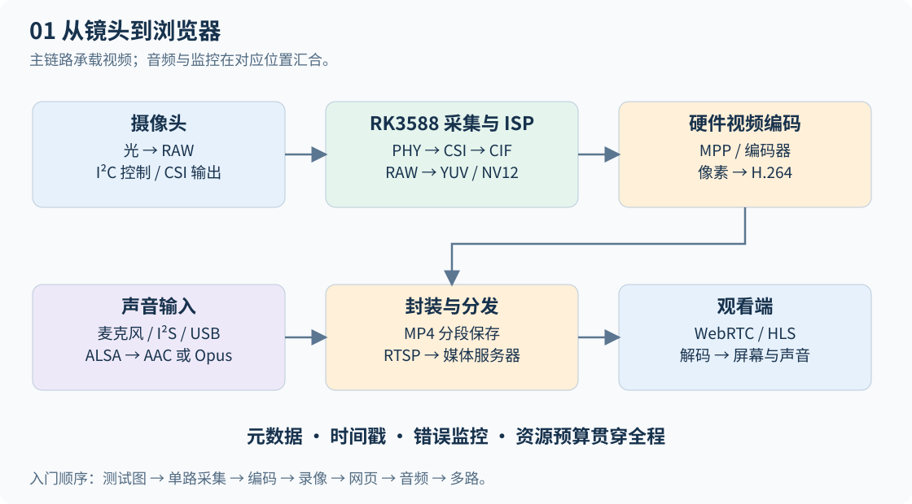

# RK3588 CSI 视频全链路开发教材

面向零基础学习者的正点原子 RK3588 摄像头开发课程：CSI-2 / D-PHY → Linux / V4L2 / ISP → GStreamer / 硬件编码 → 录像与网页推流 → 解码显示 → 多路 CSI 与 AI。包含完整教材、可运行的本地学习网站、原理图源码和实验示例。



## 下载和启动

```bash
git clone https://github.com/Huqiqiqi/CSI-Study.git
cd CSI-Study
```

推荐先双击 **启动学习网站.cmd**，打开本机学习网站 **http://127.0.0.1:8765**。网站保留全部教材，提供 79 个学习小节、搜索、进度、笔记、原理图放大、带宽实验台和 AI 提问入口。详见 [学习网站使用说明](学习网站使用说明.md)。

已有 API URL 与 Key 可在网站右上角“API 设置”连接 Responses 或 Chat Completions 兼容服务；密钥仅保存在本机服务内存。未配置时仍可检索教材原文。网站运行需要 Python 3.10 或更新版本，本机启动器会使用已有运行环境。

也可以双击 [index.html](index.html) 阅读原来的完整单页教材。此版本不需要安装依赖或连接互联网，正文图形已经内嵌；外部参考资料需要联网。

内容包括九章主线、环境预检、20 个主线实验、4 项驱动进阶练习、12 幅原创示意图、带宽与存储计算器、排错表、自测答案和板端示例。

- [教材 Markdown 源稿](教材.md)：方便编辑与做笔记，需要相邻 assets 图片目录。
- [实验程序说明](examples/README.md)：代码在 Linux 开发板执行，先核对真实节点和插件。
- [板卡档案模板](templates/board-profile.md)：记录模组、SDK、设备树和验证结果。
- [验证报告](验证报告.md)：本机已完成的检查与尚需板端完成的验收。

## 第一次开始

1. 阅读导读，区分内核版本、发行版和 SDK。
2. 摄像头未到手时，先做第三章的测试图和软件编码，再做第五章网页播放。
3. 接好匹配的配套模组后，按第二章确认媒体拓扑和实际 NV12 输出节点。
4. 单路采集与录像稳定后，再扩展到声音和多路。

摄像头建议以适配正点原子实物底板的 IMX415 套件建立基线。任何 `/dev/videoN`、GPIO、时钟和 DTS 都须与自己的 SDK 对照，教程不替代原理图。

工具目录中的构建与 QA 脚本用于生成教材，无需在板端运行。图片同时提供 SVG 与 PNG，位于 assets，可用于学习笔记。未修改工作区原有文档。

## 仓库目录

| 目录或文件 | 用途 |
| --- | --- |
| `learn/` | 学习网站前端、Python 服务和生成的课程数据 |
| `chapters/` | 按章节组织的 Markdown 教材源码 |
| `assets/` | 12 张原创原理图，SVG 与 PNG 格式 |
| `examples/` | Linux / RK3588 实验脚本、推流配置和播放器示例 |
| `templates/` | 板卡与实验记录模板 |
| `tools/` | 构建、图形生成、检查、测试和打包脚本 |
| `教材.md`、`index.html` | 完整教材及可离线打开的单页版本 |

Linux / macOS 或手动运行时，在仓库根目录执行：

```bash
python3 learn/server.py --port 8765
```

然后打开 `http://127.0.0.1:8765`。运行网站只需 Python 3.10+ 的标准库。此仓库没有启用 GitHub Pages；带 AI 提问功能的网站需要本机 Python 后端，不能仅靠静态托管运行。

## 修改教材与开发验证

直接阅读或启动网站不需要 Node.js。需要重新构建时，准备 Node.js 22.12+，在根目录执行：

```bash
npm install
npm run build
python3 tools/check_content.py
python3 tools/test_learning_server.py
```

`npm run build` 从 `chapters/*.md` 重新生成 `教材.md`、完整 `index.html` 和 `learn/course.json`。使用 Windows 时，可将上述 `python3` 换成自己的 Python 命令。

浏览器检查需要 Playwright 浏览器。Windows 会优先使用已安装的 Edge；其他环境可安装 Chromium：

```bash
npx playwright install chromium
npm run test:reader
```

网站浏览器测试会设置并清除测试 API 配置。请使用独立测试服务，避免影响你正在学习的服务：

```bash
# 终端 1：启动独立测试服务
python3 learn/server.py --port 8771

# 终端 2：Linux / macOS
RK_LEARNING_TEST_URL=http://127.0.0.1:8771 npm run test:site
```

PowerShell 终端 2 对应：

```powershell
$env:RK_LEARNING_TEST_URL = 'http://127.0.0.1:8771'
npm run test:site
```

可用 `PLAYWRIGHT_EXECUTABLE_PATH` 指定浏览器程序路径；开发工具也支持 `CODEX_NODE_MODULES` 依赖目录作为可选回退，不要求安装 Codex。

运行日志、密钥配置、`examples/env.sh`、缓存、录像和临时学习记录均在 `.gitignore` 中排除。API 密钥在网页中填写，只保留在服务运行内存；不要提交到仓库。

验证范围见 [学习网站验证报告](学习网站验证报告.md)：已完成本地软件与模拟 API 测试，未连接用户的实际开发板，也未验证用户真实 API 服务。
