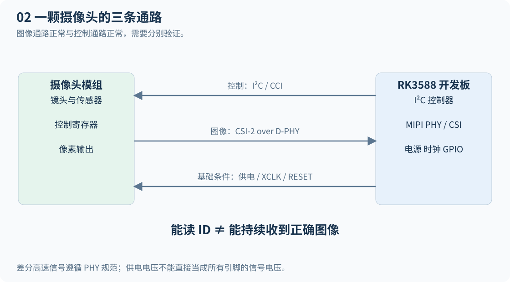
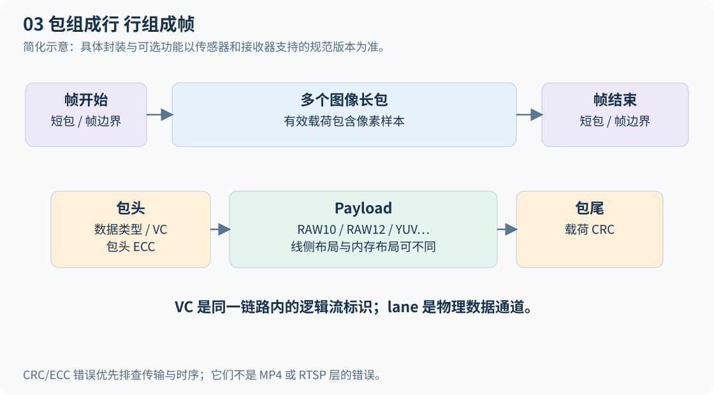
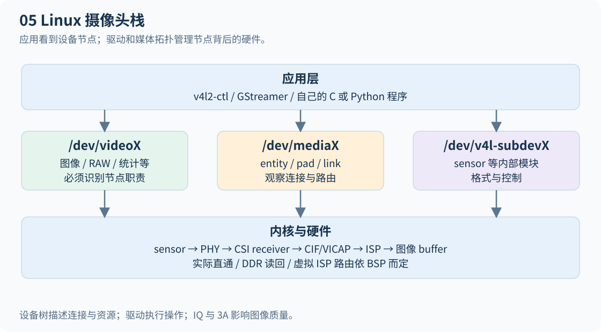
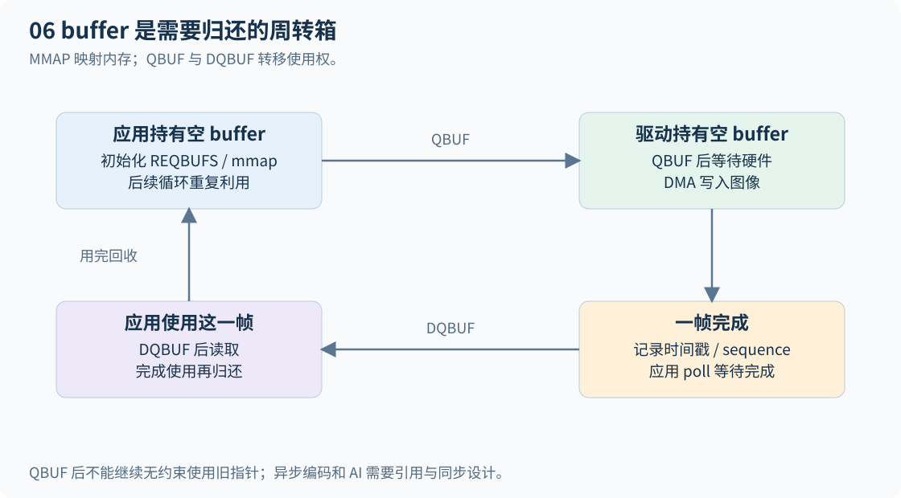
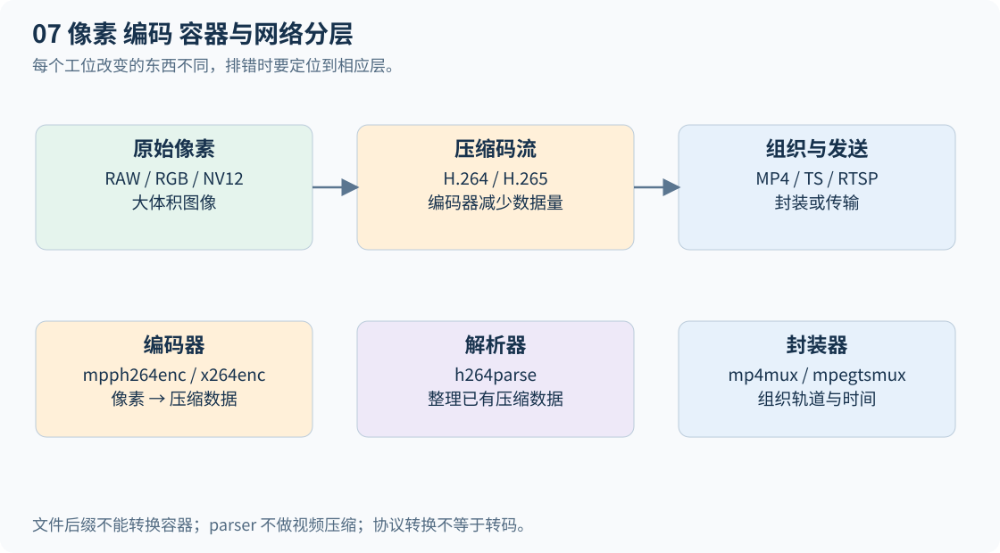
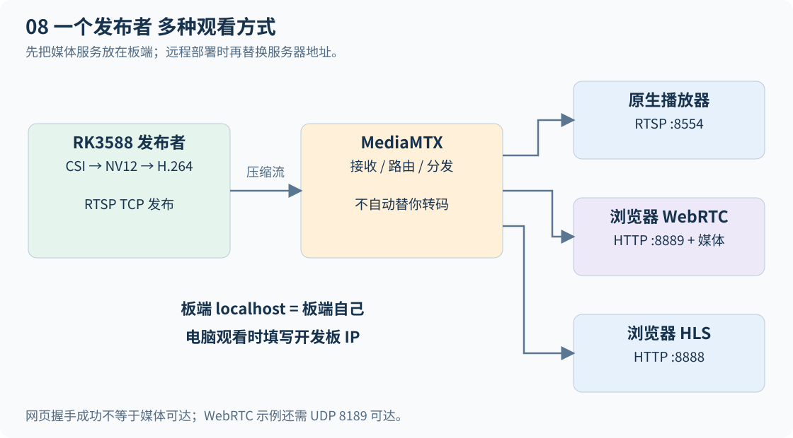
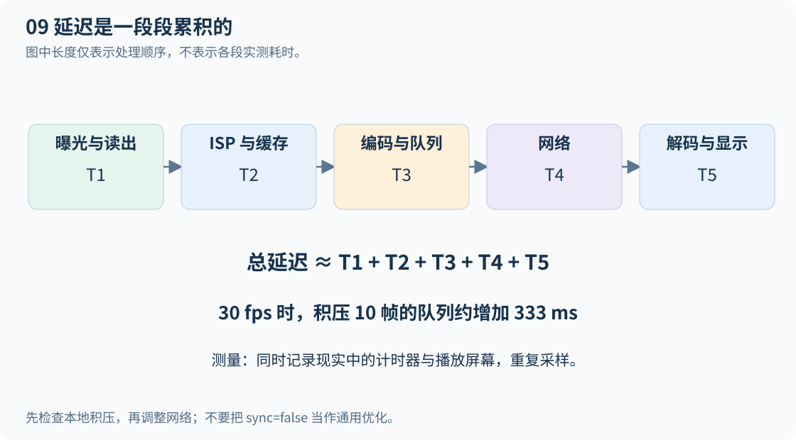
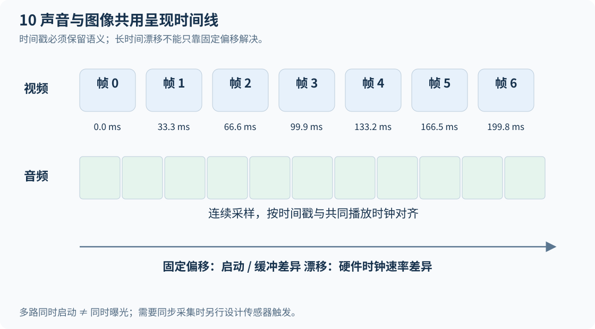
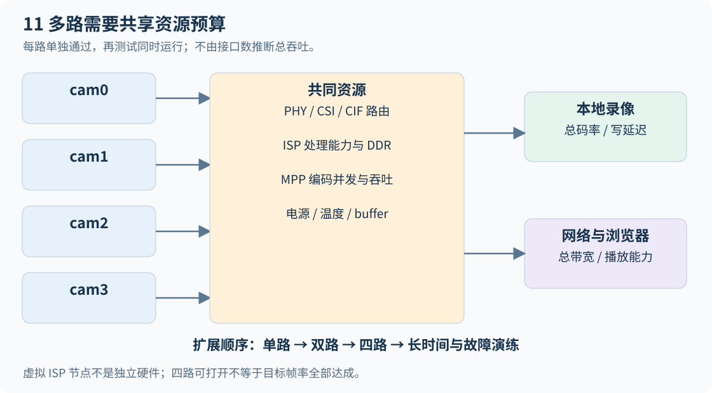
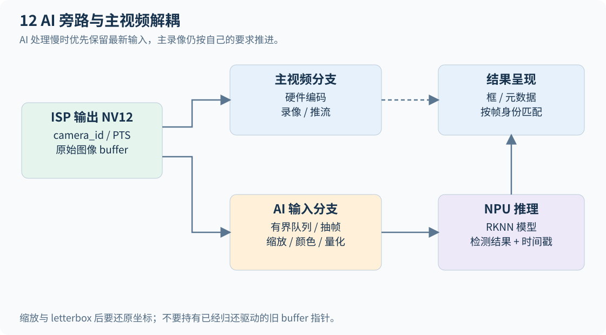

# 从零打通正点原子 RK3588 CSI 视频全链路

面向第一次接触 Linux 摄像头开发的学习者 · 图文开发教材 · 2026 年 10 月 14 日

你最终要做出这样的系统：正点原子 RK3588 接入摄像头，Linux 能稳定取得图像，硬件编码器把图像压缩成 H.264，视频既能保存为分段录像，也能通过网络在电脑或手机浏览器里播放；随后扩展到多路摄像头、声音和 AI。学习的重点是能够解释每一步的数据是什么、谁负责处理、失败时去哪里找证据。

本书沿用九章结构，并把“视频编码”补入第三章，把“多路 CSI 工程”放在第九章。编码是采集与存储、推流之间的必经环节，不能等到第七章讲解码时才接触。普通摄像头 CSI 链路主要承载图像；声音通常由麦克风、音频 Codec、I²S/PDM 或 USB 音频进入 ALSA，再与视频汇合。


## 阅读前先确认的事实

**你的设备**：正点原子 RK3588；摄像头尚未选定；“Linux6/12”尚未对应到准确的内核和发行版。Linux 6.1、Linux 6.12、Debian 12、Android 12 是不同的信息，不能互相替代。请先做实验 0，记录实际输出。

**板卡参考范围**：正点原子 ATK-DLRK3588 系列官方资料，硬件接口说明具体指向 ATK-DLRK3588B。实物底板修订版、原理图和 SDK 版本仍需核对。官方硬件文档描述四个 2×11 针、2.0 mm 排座摄像头接口，支持四条数据 lane；并非通用树莓派 FPC 接口。模组供电与控制信号电平不能混为一谈。[官方硬件接口说明](https://wiki.alientek.com/docs/Boards/Linux/DLRK3588/DLRK3588%20硬件参考手册/describe/3.13/)

**软件版本差异**：官方摄像头测试页同时保留早期出厂系统的双路说明和 R8 SDK 的四路更新。更新指定 `atk-rk3588_linux_release_R8_v1.0_20250104.tgz`，支持四路配套 IMX415。该结论不等于任意镜像、任意内核、任意四颗摄像头都可以直接使用。[官方摄像头测试说明](https://wiki.alientek.com/docs/Boards/Linux/DLRK3588/DLRK3588%20快速体验手册/function_test/3.8_camera/)

**推荐第一颗摄像头**：优先考虑与实物板卡修订版匹配的正点原子配套 IMX415 模组，购买前确认接口、电平、支持的镜像和 IQ 文件。IMX415 芯片型号相同，不代表不同厂家的模组插脚、时钟、镜头和调校相同。先用原厂组合获得正常图像，再做移植，能够把“我写错了”与“模组本身不匹配”区分开。

**验证边界**：本书核对了官方网页、Linux 接口文档和公开源码；配套程序做本机能够完成的静态与离线检查。未连接你的开发板，未对 CSI 电气、板端插件、编码性能或四路吞吐做实机验收。文中的“预期现象”是实验目标，不是假定已经测出的结果。

## 九章怎样学习

| 章节 | 本章要回答的问题 | 可交付的学习成果 |
| --- | --- | --- |
| 一 视频输入与采集 | 摄像头怎样把光变成字节送进 SoC | 模组接线核对表、带宽预算 |
| 二 驱动与底层媒体处理 | Linux 怎样找到摄像头并得到第一帧 | 系统清单、媒体拓扑、采集记录 |
| 三 音视频框架与编码 | 怎样连接处理模块并压缩图像 | 测试图 pipeline、H.264 样本 |
| 四 封装与本地存储 | 怎样做可回放、可轮转的录像 | MP4 分段、存储容量估算 |
| 五 实时流媒体 | 怎样把编码视频送到浏览器 | RTSP 发布、WebRTC 与 HLS 播放 |
| 六 分发与安全 | 怎样让其他机器可靠访问 | 地址端口表、部署与故障恢复策略 |
| 七 解码与硬件加速 | 压缩数据怎样变回画面 | 软硬解码对照、格式边界记录 |
| 八 本地播放与显示 | 怎样送到屏幕并对齐声音 | 本地预览、音画同步实验 |
| 九 辅助环节与多路工程 | 怎样长期运行并扩展能力 | 多路资源矩阵、监控、AI 旁路 |

先走“测试图 → 单路采集 → 单路编码 → 本地录像 → 局域网网页 → 音频 → 多路”的路线。不要第一天同时修改驱动、升级内核、打开 HDR、接四路摄像头并调 WebRTC。每一步保存可重现的命令与日志，下一步失败时，回到最后一次成功的状态。

## 实验 0 认清三台角色和一个版本基线

**开发电脑**负责阅读文档、编辑源码和编译 SDK；**RK3588 板端**负责摄像头采集与硬件编解码；**观看客户端**负责浏览器播放。开发电脑也可以兼任观看客户端。流媒体服务最初放在板端，熟练后再移到服务器。

全书标注“板端 Bash”的命令在开发板 Linux 终端执行，不要粘贴到 Windows PowerShell。`$CAM` 是变量，`!` 是 GStreamer 元件连接符，行末 `\` 是 Bash 续行符，`#` 后面是注释。每次新开终端都要重新设置需要的变量。代码中的 `REPLACE_...`、`YOUR_...` 是必须替换的占位符。

```bash
# 板端 Bash：只读取信息，不修改内核
uname -a
cat /etc/os-release
tr -d '\0' < /proc/device-tree/model
printf '\n'
cat /proc/cmdline
v4l2-ctl --list-devices
gst-launch-1.0 --version
ffmpeg -version
```

如果 `v4l2-ctl` 或 `gst-launch-1.0` 不存在，记录缺项。Debian/Ubuntu 镜像可以通过其软件包系统补充工具；Buildroot 通常需要在 SDK 中启用软件包并重新生成根文件系统，不能把 `apt install` 当作通用办法。不要为安装一个工具就把整套厂商多媒体组件替换为另一发行版版本。

解压本书配套文件，在板端进入 `examples`，执行 `bash 00_probe.sh`，会生成独立诊断目录，包含设备节点、媒体拓扑和插件探测。脚本不安装软件、不扫描 I²C、不改设备树，也不会自动上传日志。

**你应该得到什么**：写下板卡版本、内核版本、发行版、SDK 包名、当前 DTB 来源、GStreamer 版本、MPP 插件是否存在。暂时不知道的填“待确认”，不要靠文件名猜内核。系统能启动只说明启动链路工作，不能证明摄像头、ISP、编码器都受支持。

## 先学会用证据说话

“驱动适配成功”至少包含以下递进证据：I²C 设备正确绑定；芯片 ID 校验通过；媒体拓扑链路合理；开始采集后持续收到有效 buffer；图像尺寸和颜色正确；停止与重启正常；压力测试下没有持续增长的错误。仅看到 `/dev/video0`，或日志出现 `probe`，都不足以宣布完成。

每次实验记录五件事：使用哪个软件版本、执行哪条命令、期望什么、实际发生什么、下一步只改哪个变量。附录提供空白记录表和按症状索引的排错表。


---

# 第一章 视频输入与采集

## 1.1 先把摄像头拆成几个容易理解的部分

镜头把光聚到传感器上，传感器像一张有很多小杯子的网格。每个像素在曝光时间里“收集光”，读出电路把结果变成数字。对普通 Bayer 传感器而言，一个位置通常只测红、绿、蓝中的一种颜色；它输出的 RAW 数据还不是我们习惯看的完整 RGB 图片。

摄像头驱动负责告诉传感器“采用哪个模式、曝光多久、增益多少、开始还是停止”。摄像头高速输出线路负责运输像素。ISP 负责把 RAW 处理成更容易显示和编码的图像；编码器负责压缩；浏览器最后解码显示。这几种工作发生在不同模块，不能指望改一个驱动寄存器就解决网页播放问题。

## 1.2 三条通路不要混淆



| 通路 | 通俗理解 | 典型内容 | 失败表现 |
| --- | --- | --- | --- |
| 控制通路 | 给摄像头下命令的电话线 | I²C/CCI 寄存器访问 | 读不到 ID、曝光设置失败 |
| 图像通路 | 运输像素的高速路 | CSI-2 over D-PHY | ID 正常但采集超时、CRC 错误 |
| 供电和时序 | 让设备有条件工作的基础设施 | 电源、复位、外部时钟 | 不响应、偶发启动、模式不稳定 |

CCI 是相机控制接口体系中的概念。当前这条 RK3588 Linux 入门路线首先看板上实际的 I²C 连接和驱动。截图里出现 I3C、C-PHY、加扰等高级主题，不意味着你手中的模组和 BSP 实现了所有新规范功能。先打通 D-PHY 常规图像流，再按实际产品资料扩展。[MIPI CSI-2 概览](https://www.mipi.org/specifications/csi-2)

## 1.3 CSI-2 和 D-PHY 分别是什么

把 CSI-2 想成“包裹怎样写收件信息、怎样分行分帧”的规则，把 D-PHY 想成“线路怎样传送电信号”的规则。常见 D-PHY 摄像头链路有一对时钟差分线和若干对数据差分线，常见模式为两条或四条 data lane。D-PHY 的高速传输和低功耗状态有不同的电气行为，不能把它简单当成普通 1.8 V GPIO。

`4-lane` 意味着同一条链路可以并行传输更多字节，不等于四个摄像头。两路独立摄像头也不能用无源“一分二”线合并成一条 CSI 链路。多路汇聚需要实际支持的桥接/解串硬件、VC 路由、驱动和接收器配置。

CSI-2 长包包含包头、有效载荷和校验；短包可用于传递帧边界等信息。包头中的数据类型帮助接收端区分 RAW10、RAW12、YUV 等内容，虚拟通道标识用于区分逻辑流。常见经典格式中的包头 ECC 和载荷 CRC，分别用于检查不同部分的传输错误。具体纠错能力、扩展 VC、可选协议能力以双方支持的规范版本为准。



如果 I²C 读 ID 成功，而 CSI 接收端累计 CRC/ECC 错误，就应检查数据线路、lane 配置、信号质量和时序。此时修改 RTSP 地址通常毫无帮助。错误计数也不能单独精确定位哪根线坏了，要结合降低速率、换线、换接口和日志比较。

## 1.4 认识 RAW RGB YUV 和 NV12

**RAW10**表示每个采样值具有 10 位信息。CSI 线上可能采用紧密打包，进入内存后也可能按 16 位容器保存。不要用“10 位”直接断言文件每像素一定占 1.25 字节；必须读取内存像素格式、行跨度和实际 buffer 大小。

**RGB888**每个像素三个 8 位通道，便于理解，但数据量较大。**YUV**把亮度信息和色度信息分开，视频系统经常使用色度抽样降低数据量。**NV12**是常见的 8 位 4:2:0 半平面布局：先放 Y 平面，再放交错的 UV 平面。**NV21**交换了 U、V 顺序，弄错后颜色会明显异常。P010 等 10 位内存格式又有不同存放方式。


以偶数尺寸、无额外对齐的 1920×1080 NV12 为例，Y 为 2,073,600 字节，UV 为 1,036,800 字节，一帧共 3,110,400 字节。实际驱动可能把每行对齐到更大的长度；应使用 `bytesperline`、每 plane 的 `sizeimage`、`bytesused` 和 `data_offset`，而不是只凭宽高计算。[Linux 半平面 YUV 格式](https://www.kernel.org/doc/html/latest/userspace-api/media/v4l/pixfmt-nv12.html)

Bayer 排列还包含 RGGB、BGGR、GRBG、GBRG 等顺序。水平或垂直翻转、裁剪起点的奇偶性可能改变颜色排列解释。画面发紫不一定是白平衡，也可能是 Bayer 顺序或 NV12/NV21 搞反；先核对数据解释，再调 IQ。

## 1.5 实验 1 算清带宽再决定分辨率

有效图像数据率的入门估算为：

```text
有效位率 = 宽 × 高 × 每秒帧数 × 每像素位数
每 lane 的最低平均有效负载 = 有效位率 ÷ data lane 数量
```

3840×2160、30 fps、RAW10：有效位率约 2.48832 Gbit/s；四 lane 平均为 622.08 Mbit/s/lane。这只是有效像素的平均负载下限。CSI 包开销、传感器行时序、突发传输窗口、HDR 多曝光和工程余量都会改变实际要求，不能把这个下限写成传感器配置值。

在常见 D-PHY DDR 定义下，lane bit rate 约为 `2 × link_freq`。例如资料明确 lane bit rate 为 1.2 Gbit/s 时，相关 link frequency 可以是 600 MHz。不要把 24 MHz 外部时钟、link frequency、像素阵列时钟和有效图像像素率当成一个量。某些旧 BSP 的控制定义有差异，最终核对驱动模式表及硬件手册。[Linux CSI 发射与接收接口](https://cdn.kernel.org/doc/html/latest/driver-api/media/tx-rx.html)

内存侧 1080p30 NV12 每次完整读或写约 93.312 MB/s；四路约 373.248 MB/s。一次 CPU 完整复制还会产生一次读加一次写。四路 4K30 NV12 每次完整读或写约 1.493 GB/s，这还没有计算 ISP、编码器、显示和其他访问。

**练习**：用教材网页内的计算器，把路数改为 4、分辨率改为 1920×1080，比较 RAW10 线侧负载、NV12 内存流量和每路 4 Mbit/s 编码后的存储量。回答：为什么网络很空闲，但内存或 ISP 仍可能忙？答案：压缩发生在采集和图像处理之后，前面仍在搬运大量原始像素。

## 1.6 模组选型与接线核对

第一次选型优先考虑可用的驱动、设备树和 IQ 配套。分辨率只是一个条件；还要明确最低照度、视场角、镜头是否可调焦、滚动快门是否可接受、线缆距离、目标帧率以及是否需要同步曝光。需要高速运动测量时，应重新评估滚动快门和全局快门，而不是单纯追求更多像素。

核对表应逐项填写：模组型号与 PCB 修订版、接口针脚顺序、GND、供电、控制 IO 电压、I²C 地址、reset/pwdn 有效电平、外部时钟频率、lane 数和顺序、输出格式、目标 mode、曝光时序、支持的 SDK。板卡官方说明中的模组 3.3 V 供电和 1.8 V 信号要求，不能被理解为把任何引脚接 3.3 V 都可以；高速差分线路遵守其 PHY 电气规范。

板子断电后按原理图和官方安装图连接，确认方向、对齐和锁紧。不要在通电时试插摄像头，也不要用长杜邦线承载高速 CSI 数据对。没有示波器时仍可以通过原厂短连接、低速模式、单路测试建立基线，但不能宣称已经完成信号完整性验证。

**本章验收**：能解释 I²C 正常为什么不等于图像正常；能区别 lane 和摄像头路数；能算出带宽下限；能说明 RAW 为什么不能直接当 NV12 显示。完成这些再进入驱动实验。


---

# 第二章 Linux 驱动与底层媒体处理

## 2.1 驱动究竟在帮你做什么

应用想要的是“给我下一帧”。硬件需要的却是一长串动作：开电源、配置时钟、释放复位、读芯片 ID、写模式寄存器、准备接收端、分配 buffer、打开数据流、处理中断。驱动把这些具体动作包装成统一接口。

**V4L2**提供视频设备与控制接口；**Media Controller**描述多个硬件模块怎样连接；**subdevice**通常表示传感器、接收器、ISP 等内部模块；**videobuf2**帮助驱动管理流式 buffer。`/dev/videoX` 不一定是可直接播放的图像出口，还可能是 RAW、统计信息、ISP 参数或编解码节点。[Linux sub-device 接口](https://docs.kernel.org/userspace-api/media/v4l/dev-subdev.html)



RK3588 BSP 中常见的概念链路是：sensor → D-PHY/DC-PHY → CSI-2 receiver → RKCIF/VICAP → ISP → YUV 输出。它是帮助理解的逻辑顺序，实际存在直通、落内存、读回以及虚拟 ISP 等路径。不要据此推断每两个模块之间都完整复制一次图像。主线内核的节点名称和驱动组织也可能不同。[Linux RKCIF 说明](https://cdn.kernel.org/doc/html/latest/admin-guide/media/rkcif.html)

## 2.2 实验 2 找到正确的图像出口

**前提**：接好配套模组，启动厂商相机支持镜像；暂时退出占用摄像头的 Qt 相机程序。不要先停止所有名字里带 ISP 的服务，部分镜像正需要 IQ 服务维持 3A。

```bash
# 板端 Bash
v4l2-ctl --list-devices
for m in /dev/media*; do
    [ -e "$m" ] || continue
    media-ctl -d "$m" -p
done
for p in /sys/class/video4linux/video*/name; do
    [ -f "$p" ] || continue
    printf '%s: ' "$p"
    cat "$p"
done
```

`media-ctl -p` 里，每个 entity 是模块，pad 是端口，link 是连线。沿 sensor 的 source pad 向后找，确认到达采集链路和 ISP 输出。看到 `ENABLED` 代表链路被启用，不等于电线已经传出正确图像。保存完整输出，在增加第二颗摄像头后再做差异比较。

官方 R8 文档给出的历史参考映射如下。它只用于识别版本差异，不能替代板端探测。

| 丝印 | 指定 R8 SDK 文档中的参考输出 |
| --- | --- |
| MIPI CSI1 | `/dev/video62` |
| MIPI CSI2 | `/dev/video71` |
| MIPI CSI3 | `/dev/video44` |
| MIPI CSI4 | `/dev/video53` |

早期出厂示例使用过 `/dev/video22`、`/dev/video31`。节点数字变化并不说明硬件损坏；设备注册数量和顺序都会影响数字。产品中应通过 entity、sysfs 路径或验证过的 udev 规则绑定摄像头身份。

找到候选 YUV 节点后设置变量。这里故意要求你填入自己的结果，防止误用另一板型的节点：

```bash
export CAM=/dev/videoREPLACE_ME
v4l2-ctl -d "$CAM" --all
v4l2-ctl -d "$CAM" --list-formats-ext
fuser "$CAM"
```

优先选择报告支持 NV12 的 ISP 输出。不要把 RAW 节点强行声明为 NV12。若返回设备忙，用 `fuser` 查占用者，正常关闭那一个应用；多个程序同时打开同一采集节点不一定受支持。

## 2.3 实验 3 先收帧 不显示 不编码

第一步沿用该节点当前可工作的格式，排除显示端干扰：

```bash
v4l2-ctl -d "$CAM" --get-fmt-video
v4l2-ctl -d "$CAM" --stream-mmap=4 --stream-count=120 \
    --stream-to=/dev/null --verbose
```

若驱动已配置到正确链路，应该看到 buffer 持续返回，采集达到数量后退出。命令卡住时可以用 Ctrl+C 结束，同时在另一个终端看 `dmesg -w`。某些系统限制普通用户读内核日志，在你管理的开发板上再使用 `sudo dmesg -w`。

第二步才试一个枚举支持的 NV12 分辨率：

```bash
# 以下仅在该输出支持此格式和尺寸时执行
v4l2-ctl -d "$CAM" \
    --set-fmt-video=width=1920,height=1080,pixelformat=NV12
v4l2-ctl -d "$CAM" --get-fmt-video
v4l2-ctl -d "$CAM" --stream-mmap=4 --stream-count=120 \
    --stream-to=/dev/null --verbose
```

一定读回格式：驱动可能调整尺寸和 stride，`S_FMT` 成功并不表示接受了每个请求值。若设置帧率不支持，不能靠添加 `--set-parm=30` 强迫 sensor 运行到 30 fps；要检查 sensor mode、VBLANK 和整个 pipeline 的协商。部分 BSP 还需要其相机管理组件启动和配置 ISP。

**验收证据**：记录实际格式、采集耗时、错误数、sequence 是否连续、实测 fps。120 帧在 30 fps 附近大约需要 4 秒，但启动预热和丢弃帧会影响墙钟时间。画面未检查前，只能说“持续收帧成功”。

## 2.4 从 buffer 理解 V4L2 应用开发

把 buffer 想成周转箱：应用把空箱交给驱动，驱动填完像素再交回，应用用完必须归还。不给空箱，摄像头即使一直工作也可能无法继续把图像交给应用。



典型 MMAP 采集流程为 `open → QUERYCAP → ENUM_FMT → S_FMT/G_FMT → REQBUFS → QUERYBUF/mmap → QBUF → STREAMON → poll/DQBUF/处理/QBUF → STREAMOFF → munmap → close`。读驱动返回的 buffer 数量，不假定申请四个就一定得到四个。[MMAP 采集](https://docs.kernel.org/userspace-api/media/v4l/mmap.html)、[REQBUFS](https://docs.kernel.org/userspace-api/media/v4l/vidioc-reqbufs.html)

`DQBUF` 返回的是“哪一个箱子好了”，不一定复制像素。应用借着映射读取内容。`QBUF` 之后驱动可再次使用该内存，因此不能把它的指针交给另一个长期任务后立刻归还。异步编码或 AI 必须处理 buffer 生命周期，可以引用计数、等待硬件完成，或选择明确的复制策略。[QBUF 与 DQBUF](https://docs.kernel.org/userspace-api/media/v4l/vidioc-qbuf.html)

多平面 API 使用 `V4L2_BUF_TYPE_VIDEO_CAPTURE_MPLANE` 和 `v4l2_plane` 数组。它和图像本身有几个颜色平面是相关但不完全相同的概念。请依据 `QUERYCAP` 和返回格式选择 API，不要拿只支持单平面的几十行示例直接覆盖所有 RKISP 节点。

```c
/* 教学伪代码：省略错误处理和单/多平面分支，不能单独编译 */
while (running) {
    wait_until_readable(fd, timeout_ms);
    dequeue_buffer(fd, &buf);  /* DQBUF */
    inspect_timestamp_sequence_and_flags(&buf);
    consume_before_requeue(&buf);
    queue_buffer(fd, &buf);    /* QBUF */
}
```

实际代码需要处理 `EINTR`、非阻塞情况下的 `EAGAIN`、超时、设备断开、buffer error flag，以及所有资源释放分支。停止流时用 STREAMOFF，不要只终止读线程却让硬件维持旧状态。[STREAMON/OFF](https://docs.kernel.org/userspace-api/media/v4l/vidioc-streamon.html)

## 2.5 设备树是板级连接说明书

设备树负责描述“哪个硬件挂在哪个总线上，用哪些电源、时钟、GPIO，图像连到哪个端口”。驱动负责实现操作。改 `compatible` 字符串不会把另一种 sensor 自动变成 IMX415，改节点名也不会改变接线。

先在**自己的 SDK 源码目录**中查找，不要把网上 DTS 整段覆盖进去：

```bash
# Linux 开发主机：在实际内核源码根目录执行
rg -n 'sony,imx415|imx415|camera-module' arch/arm64/boot/dts/rockchip
rg -n 'CONFIG_VIDEO_IMX415|VIDEO_IMX415' drivers/media/i2c .config
rg -n 'imx415|csi2_dphy|rkcif|rkisp' drivers/media
```

设备树片段的结构可以这样阅读。下面是**不可部署的结构模板**，所有 `REPLACE_...` 必须来自本板原理图和已工作的 DTS；并未给未知板卡编造 GPIO 或时钟编号：

```dts
&REPLACE_I2C_CONTROLLER {
    status = "okay";
    camera@1a {
        compatible = "sony,imx415";
        reg = <0x1a>; /* 示例，仍需核对模组地址 */
        clocks = <&REPLACE_CLOCK_CONTROLLER REPLACE_CLOCK_ID>;
        clock-names = "xvclk"; /* 这是部分 BSP 的名称 */
        /* supplies、GPIO、pinctrl、模块信息取自匹配 BSP */
        port {
            sensor_out: endpoint {
                remote-endpoint = <&REPLACE_PHY_INPUT>;
                data-lanes = <1 2 3 4>;
            };
        };
    };
};
```

逐段追踪 sensor → PHY 输入、PHY 输出 → CSI host、CSI → CIF、CIF → ISP。两端 `remote-endpoint` 应正确对应，相关硬件节点应启用；PHY 硬件节点与逻辑端口可能分别需要启用。`data-lanes` 是线路映射，不能只在一端把 2 改成 4 就认为完成提速。

主线 binding 与 Rockchip BSP 可能在 `clock-names`、电源字段、模块信息和路由组织上不同。应该查同一源码树的 binding 与驱动解析代码。网上 `xvclk`、`inck` 的差别有时只是接口约定不同，不能随意互换。[设备树 binding 编写原则](https://www.kernel.org/doc/html/latest/devicetree/bindings/writing-bindings.html)

运行中的设备树也要核实。安装了 dtc 且内核暴露对应目录时，可在板端导出：

```bash
dtc -I fs -O dts /sys/firmware/devicetree/base > running-tree.dts
```

导出可能带警告和数字 phandle，适合审计，不建议把它直接当作维护源码。源码中的标签不会完整保留。修改了文件但效果不变时，要核查 bootloader 实际加载的 DTB/overlay，而不是反复改同一份未被加载的文件。

## 2.6 一次真正的 sensor 驱动适配怎样推进

**第一阶段 读懂已有驱动**。以匹配 SDK 的 `drivers/media/i2c/imx415.c` 为例，寻找 probe、供电、模式表、格式协商、control 和启停流代码。公开 Rockchip `develop-6.1` 分支可用于对照，但不能替代正点原子交付源码。[Rockchip IMX415 源码](https://github.com/rockchip-linux/kernel/blob/develop-6.1/drivers/media/i2c/imx415.c)

**第二阶段 固定一个模式**。先做单路、线性 SDR、一个分辨率和一个帧率。记录 input clock、lane 数、位深、link frequency、HTS/HMAX、VTS/VMAX、曝光和增益范围。HTS/HMAX 在不同传感器手册里的计量单位可能不同，不能把所有寄存器直接按像素数解释。

**第三阶段 供电与 ID**。按手册处理 regulator、clock、reset/pwdn 和延时，读真实的芯片 ID，校验失败应返回错误。`-EPROBE_DEFER` 常表示依赖资源尚未就绪；I²C ACK 只能证明地址上有响应，不证明型号和模式正确。普通 `i2cdetect` 扫描也有设备副作用，第一轮优先读取驱动日志，不自动盲扫总线。

**第四阶段 格式与控制**。枚举支持的 bus code、尺寸和帧间隔，区分 TRY 与 ACTIVE 状态。实现曝光、模拟增益、blanking 等 control，并在改变 VBLANK 后更新合法曝光范围。驱动默认值、实际寄存器值和应用看到的 control 要一致。[V4L2 controls](https://docs.kernel.org/driver-api/media/v4l2-controls.html)

**第五阶段 流与电源管理**。start 时恢复电源、写模式表、应用 controls，最后开启输出；失败时回滚资源。stop 时停止传感器，配合 runtime PM。新内核逐步使用 streams API，很多 BSP 仍使用 `.s_stream`，函数签名和状态结构应从本树复制。不要从最新主线教程粘 API 到旧 BSP 后靠强制类型转换压掉警告。[Linux sensor 驱动指导](https://cdn.kernel.org/doc/html/latest/driver-api/media/camera-sensor.html)

**第六阶段 图像和耐久性**。先检查静态画面，再检查运动、暗光、重复启停、长时间运行。自动曝光下帧率可能变化，必须分辨应用请求帧率、传感器真实帧率和重复显示帧。正式加入 HDR 前，确认短长曝光、VC、ISP 模式和 IQ 都有配套。

## 2.7 帧率 曝光和模式表的关系

对于采用相应像素时序定义的传感器，可用 `帧时间 = (有效宽 + 水平 blanking) × (有效高 + 垂直 blanking) ÷ 像素阵列时钟` 理解帧率。扩大 VBLANK 往往会延长帧时间，也扩大可能的曝光窗口；曝光不能任意超过帧时间允许的范围。注意这里的像素阵列时钟不一定等于 CSI 总线推导的像素率。[Linux sensor 时序解释](https://cdn.kernel.org/doc/html/latest/userspace-api/media/drivers/camera-sensor.html)

调试实验：在驱动明确支持的 control 范围内，关闭自动曝光或让 3A 进入对应手动模式，逐步改变曝光，记录画面亮度和帧间隔。若 IQ 服务仍在自动调节，你手工写下的值可能立刻被覆盖；先明确“谁拥有控制权”。不要向未知寄存器写猜测值。

## 2.8 编译 部署与可回滚的验证

使用正点原子对应 SDK 和编译说明，先原样编译一次，证明工具链和配置可复现。保存内核 commit/版本、defconfig、DTS 文件和编译日志。随后一次只改一个问题。厂商的 `build.sh` 子命令随 SDK 不同，本书不假定统一的烧写命令。

内核模块编译需要匹配运行内核的配置、生成头文件、ABI 和符号版本。`uname -r` 相同仍不充分；不同编译配置也可能不兼容。模块载入报 `invalid module format` 时检查 `modinfo`、vermagic 和内核日志，不要强制忽略版本。静态编入内核的驱动不能靠替换一个 `.ko` 更新。[Linux 外部模块构建](https://www.kernel.org/doc/html/latest/kbuild/modules.html)

部署前保留已知可启动镜像、DTB 和恢复方式，确认系统分区与烧写工具对应本板。初学者更适合在备用启动介质上验证。启动后检查运行版本和设备树，再重复实验 2、3，不能只看编译器退出码就说硬件适配成功。

## 2.9 ISP 与 IQ 为什么是独立工作

ISP 处理去马赛克、黑电平、降噪、颜色和其他图像处理；3A 通常指自动曝光 AE、自动白平衡 AWB、自动对焦 AF。没有可控镜头的模组不一定具备 AF。Rockchip 系统中的 RkAIQ/IQ 文件和服务启动方式依赖 SDK；从配套启动脚本或进程确认实际机制。

```bash
ps -ef | grep -Ei 'rkaiq|rkisp|camera' | grep -v grep
find /etc /usr/share -maxdepth 4 -iname '*iq*' 2>/dev/null
```

图像能出但很暗、偏色或噪点大，既可能是 IQ，也可能是格式解释、镜头、供电或曝光。先确保 RAW/Bayer 顺序和基本寄存器正确，再处理调校。IQ 与模组、镜头、模式匹配，不要用另一颗 sensor 的文件“改名冒充”。

## 2.10 第一段驱动代码应该怎样读

初学者遇到驱动代码，不妨先认识几个写法：`struct` 把同一设备的信息放在一起，指针指向这份信息，`->` 访问指针所指结构里的成员，`ret` 保存操作结果，负数通常代表内核错误，`goto` 常用于统一回收已经申请的资源。函数指针表类似“操作菜单”：框架调用菜单中的 set_fmt、set_ctrl 或 stream 函数，具体函数再操作硬件。

以下是**16 位寄存器地址加 8 位值协议的教学辅助函数**。它不包含任何初始化寄存器，不是完整 sensor 驱动，也不能未经核对就替换其他协议的读写函数：

```c
#include <linux/i2c.h>
#include <linux/errno.h>

static int lesson_write_reg8(struct i2c_client *client,
                             u16 reg, u8 value)
{
    /* 先发寄存器地址高字节，再发低字节，最后发一个值 */
    u8 payload[3] = { reg >> 8, reg & 0xff, value };
    int ret = i2c_master_send(client, (const char *)payload,
                              sizeof(payload));

    if (ret < 0)
        return ret;  /* 保存总线给出的真实错误 */
    if (ret != (int)sizeof(payload))
        return -EIO; /* 短传输也不是成功 */
    return 0;
}
```

`client` 已经代表一个具体 I²C 设备地址，所以 payload 不再手工塞入另一份 I²C 从地址。`reg >> 8` 和 `reg & 0xff` 拆开寄存器地址；它们与传感器输出 RAW10 位深没有直接关系。代码中 char 指针转换只用于把这段字节交给对应接口。I²C 读寄存器往往要先写寄存器地址再读数据，是否要求 repeated START、寄存器地址宽度、数据宽度，都由器件协议决定。[Linux I²C 客户端驱动](https://docs.kernel.org/i2c/writing-clients.html)

这个函数只解决“发送一次写操作”。它没有负责开电源、锁保护、自动重试、寄存器缓存、模式选择或 stream 状态。向正确地址发送了三个字节，只说明总线传输达到预期长度，不能证明设置的参数组合能出图。真实驱动应继续保留上层错误传播和状态回滚。

再用下面的**流程伪代码**理解模式切换，不要当作跨内核版本的可编译实现：

```text
start_stream:
  加锁
  取得运行时电源引用，失败就退出
  写入已经验证的当前模式寄存器表
  应用当前曝光与增益等控制值
  写开始输出寄存器
  只有全部成功，才记录 streaming = true
  若中间失败，释放本次电源引用并保留错误码
  解锁

stop_stream:
  加锁
  请求传感器停止输出并处理失败
  按框架约定释放电源引用、恢复状态
  解锁
```

阅读你 SDK 里的实现，给每一步标出函数名。然后回答：为什么模式表写到一半失败时，不应该仍把 streaming 设为 true？因为软件会误以为硬件已成功开始，后续启停与资源引用都可能失配。驱动适配不仅是“让成功路径跑起来”，还包括让失败路径可恢复。

**本章验收**：保存一份媒体拓扑、一个持续采集结果、一张正常图像和一份版本清单。能沿着一次 STREAMON 解释从应用到 sensor 的主要调用职责，能说出设备树、驱动和 IQ 分别解决什么问题。


---

# 第三章 音视频处理框架与编码

## 3.1 用传送带理解 GStreamer

一个 pipeline 像一条装配线：source 提供数据，filter 改变数据，encoder 压缩数据，muxer 整理音视频，sink 消费数据。GStreamer 中的 element 是工位，pad 是进出口，caps 是双方约定的材料规格，buffer 是带着时间戳的数据，bus 是向应用报告错误与状态的通知通道。

```text
v4l2src → NV12 图像 → H.264 编码器 → h264parse → MP4 封装器 → 文件
```

这里 `video/x-raw` 表示未压缩像素，`video/x-h264` 表示压缩视频。`h264parse` 整理码流结构、对齐和相关信息，不负责压缩；`videoconvert` 改像素格式，不把 RAW Bayer 自动变成经过完整 ISP 调校的彩色视频。

FFmpeg 更像方便处理文件、转码和分析码流的工具箱。GStreamer 适合搭建持续运行和分支处理的 pipeline。Rockchip MPP 是通向硬件编解码能力的一层软件；RGA 处理二维图像变换；ISP 处理相机图像。三者职责不同。[MPP 官方项目](https://github.com/rockchip-linux/mpp)

## 3.2 实验 4 不接相机也能完成第一条 pipeline

```bash
# 板端 Bash 或装有 GStreamer 的 Linux 电脑
gst-inspect-1.0 videotestsrc
gst-launch-1.0 -v videotestsrc num-buffers=60 \
    ! video/x-raw,width=640,height=360,framerate=30/1 \
    ! fakesink
```

`videotestsrc` 生成测试图；`num-buffers=60` 限制输出数量；caps 限定规格；`fakesink` 丢弃数据。没有 live 时钟约束时，测试图可能很快处理完，不能拿这里的运行时间测摄像头帧率。

有桌面显示环境再运行：

```bash
gst-launch-1.0 -v videotestsrc is-live=true \
    ! video/x-raw,width=640,height=360,framerate=30/1 \
    ! videoconvert ! autovideosink
```

`is-live=true` 模拟实时源。看到测试图说明基础框架和显示路径可用，不代表 CSI 驱动已经工作。纯 SSH 终端没有显示会话时，继续用 `fakesink`。

遇到 `no element` 就缺元件或插件加载失败；`not-negotiated` 通常是相邻元件格式不一致；`Device or resource busy` 是设备占用；无法打开显示器则检查桌面、权限和 sink。先把长 pipeline 缩短，找到最早失败的一段。

## 3.3 编码不是把文件扩展名改成 H.264

未压缩图像很大，编码器利用空间和时间冗余减少数据量。I 帧可以理解为较独立的图像描述，P 帧主要借助已有参考帧，B 帧还可能利用双向参考。IDR 是一种让解码参考关系重新开始的重要随机访问点；不是所有 I 帧都等价于 IDR。

**码率**是每秒输出多少压缩比特，决定网络与磁盘预算；**帧率**是每秒多少张图；**分辨率**是一张图多少像素；**GOP**描述帧组关系。缩短关键帧间隔一般有助于新观众更快加入和切片，但也会影响码率或画质。B 帧和前瞻分析可能改善压缩，却增加缓存和重排需求。



起步选择 H.264、8 位 4:2:0、SDR，WebRTC 路线优先无 B 帧并确认 profile 兼容。H.265 可能更节省码率，但不能默认所有浏览器、设备和传输方式都支持；以目标浏览器测试为准。[浏览器编解码兼容说明](https://mediamtx.org/docs/features/webrtc-specific-features)

## 3.4 实验 5 软件编码建立可检查的样本

**前提**：`gst-inspect-1.0 x264enc`、`h264parse`、`mp4mux` 均成功。x264 软件编码适合低分辨率入门，不作为 RK3588 多路硬件性能的替代证明。

```bash
gst-launch-1.0 -e -v \
    videotestsrc is-live=true num-buffers=150 \
    ! video/x-raw,format=I420,width=640,height=360,framerate=30/1 \
    ! x264enc tune=zerolatency speed-preset=ultrafast \
        bitrate=1000 key-int-max=30 bframes=0 \
    ! h264parse ! mp4mux ! filesink location=test-pattern.mp4
ffprobe -v error -show_streams -show_format test-pattern.mp4
```

预期得到约 5 秒 MP4。读取 `codec_name`、width、height、时长与帧率，打开文件观察颜色和运动。`bitrate=1000` 是 x264enc 的 kbit/s；不能直接把这个数复制到单位为 bit/s 的另一编码器。`-e` 让 gst-launch 在正常中断时尝试发送 EOS，帮助封装器完成收尾。

文件存在不代表有效：大小为零、只有头没有帧、缺少索引，都可能导致无法播放。使用 ffprobe 验证结构，再实际解码检查。

## 3.5 实验 6 在 RK3588 上找到硬件编码能力

```bash
gst-inspect-1.0 mpph264enc
gst-inspect-1.0 mppvideodec
ffmpeg -hide_banner -encoders
ffmpeg -hide_banner -decoders
```

厂商镜像可能提供 `mpph264enc` 和 `mppvideodec`，也可能采用不同插件组合。普通发行版 FFmpeg 不一定有 Rockchip H.264 硬件编码器；看到 `rkmpp` 字样也要区分它出现在解码器还是编码器列表。不要默认 `-c:v h264_rkmpp` 在任何版本都存在。

插件存在后，保存 `gst-inspect` 输出，读 sink caps、可接受内存类型、码率单位、GOP、profile 等属性。有些厂商版本使用 `bps`、`gop` 等名称；教材脚本默认不盲目传入这些版本相关属性。

在该硬件编码器确实支持 NV12 测试输入时运行：

```bash
gst-launch-1.0 -e -v \
    videotestsrc is-live=true num-buffers=150 \
    ! video/x-raw,format=NV12,width=1280,height=720,framerate=30/1 \
    ! mpph264enc ! h264parse ! mp4mux \
    ! filesink location=hw-pattern.mp4
```

此时使用默认编码参数，只验证通路；正式推流前需要根据本机属性设置并检查目标码率、关键帧间隔和 B 帧情况。用 ffprobe 查看输出，再对比 CPU 占用和插件日志。CPU 占用低是辅助证据，选择了什么插件、插件调用的后端与输出质量才共同构成验证。

## 3.6 实验 7 用真实 CSI 图像替换测试图

**前提**：第二章持续采集通过，变量 CAM 指向正确 ISP YUV 输出，选择的尺寸与帧率已验证。

```bash
gst-launch-1.0 -e -v \
    v4l2src device="$CAM" io-mode=mmap num-buffers=150 \
    ! video/x-raw,format=NV12,width=1920,height=1080,framerate=30/1 \
    ! mpph264enc ! h264parse ! mp4mux \
    ! filesink location=csi-single.mp4
```

先用 MMAP 降低问题复杂度。如果 mpph264enc 不支持当前内存导入或格式，返回到测试图验证，检查 BSP 插件说明；不要无限堆叠 `videoconvert`。CPU 转换可能帮助定位格式问题，也可能掩盖性能瓶颈。

成功后再尝试 `io-mode=dmabuf`，观察 caps、日志、稳定性和占用变化。DMA-BUF 允许不同设备共享 buffer 引用，但不会自动保证零复制；格式、stride、modifier、对齐、缓存同步和生命周期必须全部兼容。[v4l2src 元件](https://gstreamer.freedesktop.org/documentation/video4linux2/v4l2src.html)

## 3.7 tee queue 和延迟的关系

`tee` 把一条数据流分给多个下游；每个分支通常需要独立 queue 才能在不同线程推进。queue 有缓冲上限，某个分支长期处理不过来，仍可能通过背压拖住整条 pipeline。它不是无限隔离器。[tee](https://gstreamer.freedesktop.org/documentation/coreelements/tee.html)

实时预览可以选择丢弃旧的**原始图像**，例如 `queue max-size-buffers=2 max-size-time=0 max-size-bytes=0 leaky=downstream`。这意味着更关注最新画面。完整录像分支一般不这样丢帧，应监控磁盘和写入速度。不要在编码后的任意 H.264 buffer 上随意丢数据，否则可能破坏参考关系，持续花屏直到后续可恢复点。[queue](https://gstreamer.freedesktop.org/documentation/coreelements/queue.html)

配套 `pipeline.py` 演示一个真正的应用如何接收 ERROR/EOS、记录处理帧率和执行正常退出。命令行验证以后再读它：理解 `Gst.init`、`parse_launch`、bus watch、GLib 主循环、PLAYING/NULL 状态。它故意不包含自动无限重启，避免把反复失败伪装成稳定服务。

## 3.8 音频入门实验

音频的原始数据一般称 PCM。48 kHz 表示每声道每秒 48,000 个采样点；S16_LE 表示有符号 16 位小端采样；双声道 PCM 的数据率是 `48000 × 16 × 2 = 1.536 Mbit/s`。AAC 和 Opus 是压缩格式，WAV 常用来包装 PCM；这些名称不处在同一层。

```bash
arecord -l
arecord -L
# 先把 AUDIO 换成 arecord 输出中真实可用的录音设备
export AUDIO=plughw:REPLACE_CARD,REPLACE_DEVICE
arecord -D "$AUDIO" -f S16_LE -r 48000 -c 1 -d 5 mic.wav
aplay mic.wav
```

`hw` 更直接地对应硬件能力，`plughw` 可以做部分格式适配。出现无声先检查声卡、输入源、capture 开关、增益和接线；音频 Codec 一词在板级电路里也可指 ADC/DAC 芯片，不等于 AAC 编码库。[ALSA arecord/aplay 手册](https://github.com/alsa-project/alsa-utils/blob/master/aplay/aplay.1)

**本章验收**：有测试图软件编码文件、测试图硬件编码文件和真实相机编码文件；能指出每条 pipeline 中哪一段发生压缩；能够解释一次 caps 错误；单独录制一段可听见的声音。


---

# 第四章 视频封装与本地存储

## 4.1 容器像一本带目录的相册

H.264 码流是压缩后的图像内容，MP4、MKV、TS 是组织这些内容与时间信息的容器。把 TS 文件命名成 `.mp4` 不会改变它的格式。排错时看 `ffprobe` 的 `format_name`，不要只看后缀。

| 形式 | 适合的入门用途 | 注意事项 |
| --- | --- | --- |
| H.264 裸流 | 检查编码器输出与参数集 | 时间信息和随机定位能力有限 |
| MP4 | 普通录像、浏览器点播 | 常规写法需要正常收尾 |
| 分片 MP4 | 分段、流式或特定录像设计 | 播放器兼容和索引仍需测试 |
| MPEG-TS | 传输和某些抗中断场景 | 无法保证断电不丢尾部数据 |
| MKV | 多种轨道与灵活容器需求 | 浏览器直接播放能力不统一 |

重新封装使用 `-c copy` 时可以保留原始压缩数据，通常不重新损失画质；转换编码才需要解码和再编码。滤镜、缩放、烧字幕一般不能只靠 copy 完成。

## 4.2 实验 8 做十秒可检查录像

```bash
# 在 examples 中，先按 README 配置 env.sh
bash 01_camera.sh record
ffprobe -v error -show_streams -show_format recordings/你的文件.mp4
ffmpeg -v error -i recordings/你的文件.mp4 -f null -
```

脚本按 `COUNT` 限定帧数，默认 300 帧；30 fps 时目标约十秒。最后一条把整个文件解码后丢弃，检查是否有明显解码错误；成功不能单独证明画面颜色或音画同步正确，还要观看。

也可以从已有测试片转出第一张缩略图：

```bash
ffmpeg -i test-pattern.mp4 -frames:v 1 thumbnail.png
```

默认文件存在时 FFmpeg 会询问是否覆盖。学习中优先使用独立实验目录，不要长期复用同一个录像文件名。

## 4.3 实验 9 自动分段录像

长时间把所有内容写到一个大 MP4，异常退出可能影响整个文件。先使用 `splitmuxsink` 按目标时间切成多个文件，让已经关闭的分段独立保存。它通常依赖关键帧边界，设 60 秒不代表每段精确到 60.000 秒。[splitmuxsink](https://gstreamer.freedesktop.org/documentation/multifile/splitmuxsink.html)

```bash
mkdir -p recordings
gst-launch-1.0 -e -v \
    v4l2src device="$CAM" io-mode=mmap \
    ! video/x-raw,format=NV12,width=1920,height=1080,framerate=30/1 \
    ! mpph264enc ! h264parse \
    ! splitmuxsink location="recordings/cam0-%05d.mp4" \
        max-size-time=60000000000
```

实际使用配套脚本 `bash 01_camera.sh segments`，会创建唯一会话目录，避免重启后又从 `00000` 开始覆盖旧片段。持续录像需要主动按 Ctrl+C 正常结束；正式后台服务要捕获退出信号、发送 EOS、等待文件收尾，再退出。

将目标关键帧间隔设置为可接受的数值后，查看每个分段时长与首帧可解码性。若编码器迟迟不给合适关键帧，分段会超长。不要靠强制切字节把压缩视频切成不可独立解码的片段。

## 4.4 MP4 与断电 你能承诺到哪里

常规 MP4 的索引信息可能在结束时完成；`faststart` 主要帮助点播时较早读取索引，不等于防断电。分片 MP4 可降低某些中断的影响，例如 FFmpeg 的 fragment 相关选项，但依然存在未落盘数据、文件系统和存储设备缓存。需结合具体播放器测试。[FFmpeg 容器选项](https://ffmpeg.org/ffmpeg-formats.html)

产品策略可以是小段录像、临时文件名、关闭后再原子改名、写入完成记录、按需要做文件与目录同步、限制日志增长，以及掉电保护。每一种策略都有吞吐与寿命成本。第一次验收先用进程正常退出和异常终止模拟，不要在唯一工作介质上反复强制断电。

## 4.5 存储容量不是摄像头像素数直接决定的

编码录像的粗略容量：`GB/天 ≈ 总码率(Mbit/s) × 10.8`，使用十进制 GB。每路 4 Mbit/s 是约 43.2 GB/天；四路是 172.8 GB/天，七天约 1.21 TB。还没有计算音频、容器、索引、日志、码率波动和可用空间余量。

反过来，1 TB 可用空间在四路合计 16 Mbit/s 下理论约保存 5.79 天。若你的业务要求七天，需要调整码率、保存策略或容量。网页内提供计算器帮助你比较，结果都是预算，不是实际画质或性能承诺。

磁盘要同时满足持续写入速度、最差写延迟、容量、掉电行为和耐久性。SD 卡标称速度不代表长时间随机负载下表现；在多路系统中记录写延迟、剩余容量和是否开始背压，远比仅看平均 MB/s 更有用。

## 4.6 实验 10 加入音频轨道

确认单独录音成功，且 `avenc_aac`、`aacparse` 可用后，再将音视频放入同一 pipeline：

```bash
gst-launch-1.0 -e -v mp4mux name=mux \
    ! filesink location=camera-with-audio.mp4 \
    v4l2src device="$CAM" io-mode=mmap \
    ! video/x-raw,format=NV12,width=1920,height=1080,framerate=30/1 \
    ! queue ! mpph264enc ! h264parse ! queue ! mux.video_0 \
    alsasrc device="$AUDIO" \
    ! audioconvert ! audioresample \
    ! audio/x-raw,rate=48000,channels=1 \
    ! avenc_aac ! aacparse ! queue ! mux.audio_0
```

录几秒后 Ctrl+C 正常结束，用 ffprobe 确认视频与音频两条 stream。镜头前拍手，同时录到拍手声，检查声画相对时间。共同 pipeline 有利于统一时钟，但不保证硬件时钟没有漂移；两小时实验比十秒实验更能发现问题。

**本章验收**：分段文件可以逐个播放；退出后末段能读取；容量预算包含音频与余量；能说清“扩展名、容器、编码”之间的区别。


---

# 第五章 实时流媒体与网页播放

## 5.1 先分清发布者 服务器和观看者

RK3588 采集并编码，是发布者；MediaMTX 接收和分发压缩媒体，是服务器；浏览器是观看者。最初服务器也在 RK3588 上，因此发布地址可以用 `127.0.0.1`。电脑浏览器里的 `127.0.0.1` 却指电脑自己，必须改成开发板局域网 IP。



RTSP 常用来控制媒体会话，视频通常通过 RTP 传输；采用 TCP interleaved 时媒体可以复用 RTSP TCP 连接。RTMP 常用于向直播平台发送流；HLS/DASH 用 HTTP 分发分段媒体；SRT 常用于弱网传输；WebRTC 适合交互性较强的浏览器实时播放。它们不等同于 H.264/H.265。

| 路线 | 适合先做什么 | 主要代价 |
| --- | --- | --- |
| RTSP → 原生播放器 | 检查网络推流是否正常 | 浏览器 video 标签通常不能直接播放 |
| HLS → 浏览器 | 先获得稳定的网页画面 | 切片与播放缓冲通常增加延迟 |
| WebRTC → 浏览器 | 降低交互等待 | 需要兼容编码和可达的媒体连接 |
| SRT → 接收服务器 | 探索丢包和抖动环境 | 浏览器端通常还需其他分发方式 |

不在本书给出“某协议必然只有 50 ms”这类保证。分辨率、GOP、编码器、队列、网络和浏览器共同决定延迟。先完成 HLS 或 WebRTC 的局域网闭环，再测量和优化。

## 5.2 实验 11 启动局域网媒体服务器

从 [MediaMTX 官方安装入口](https://mediamtx.org/docs/kickoff/install) 选择匹配板端 `uname -m` 和系统的发行包。常见 RK3588 Linux 是 aarch64，对应 Linux ARM64；不要下载 Windows 或 x86_64 包。记录版本，使用该发行包自带配置核对字段。教材核对时官方配置参考页标注 v1.21.2，未来版本变化需要重新确认。[配置参考](https://mediamtx.org/docs/references/configuration-file)

将可执行程序和 `mediamtx.local.yml` 放在板端，运行：

```bash
./mediamtx --version
./mediamtx mediamtx.local.yml
```

保持此终端运行，查看监听日志。配套配置只开放 `cam0` 到 `cam3` 路径，允许本机发布，并限制匿名读取来自回环和常见私网地址。它适用于你信任的实验局域网；连接反向代理、VPN 或路由转发时，要重新设计访问权限。外部设备发布会被拒绝，需要另行配置明确的发布权限。

最关键的地址约定如下，实际以配置和启动日志为准：

| 用途 | 示例地址 | 协议与端口 |
| --- | --- | --- |
| 板端发布 cam0 | `rtsp://127.0.0.1:8554/cam0` | RTSP TCP 8554 |
| 电脑检查 RTSP | `rtsp://开发板IP:8554/cam0` | RTSP TCP 8554 |
| 浏览器 HLS 页面 | `http://开发板IP:8888/cam0` | HTTP TCP 8888 |
| 浏览器 WebRTC 页面 | `http://开发板IP:8889/cam0` | HTTP TCP 8889 |
| WebRTC 媒体 | 通过协商连接开发板 | 示例 UDP 8189 |

HTTP 页面能打开只证明网页端口可达，不证明 WebRTC 媒体连接已经建立。MediaMTX 支持多协议分发，但不会凭空把任何视频转码成任意浏览器支持的格式。[服务架构概览](https://mediamtx.org/docs/kickoff/introduction)

## 5.3 实验 12 用测试图证明网络链路

确认 `rtspclientsink` 可用，在另一个板端终端运行：

```bash
gst-launch-1.0 -e -v \
    videotestsrc is-live=true \
    ! video/x-raw,format=I420,width=640,height=360,framerate=30/1 \
    ! x264enc tune=zerolatency speed-preset=ultrafast \
        bitrate=1000 key-int-max=30 bframes=0 \
    ! video/x-h264,profile=baseline \
    ! h264parse \
    ! rtspclientsink protocols=tcp location=rtsp://127.0.0.1:8554/cam0
```

服务器应报告收到发布流。电脑用播放器测试 RTSP，再用浏览器打开上表的 WebRTC 或 HLS 页面。只有测试图完整通过，才替换 CSI 输入。官方 GStreamer 发布路线使用 `rtspclientsink`，它会选择合适的 RTP payloader；不要照抄另一种 UDP pipeline，把 `rtph264pay` 再随意塞在它前面。[GStreamer 发布说明](https://mediamtx.org/docs/publish/gstreamer)

如果设备缺少 rtspclientsink，可先把已编码 MP4 用 FFmpeg 复制发布，独立检验服务：

```bash
ffmpeg -re -stream_loop -1 -i test-pattern.mp4 \
    -an -c:v copy -f rtsp -rtsp_transport tcp \
    rtsp://127.0.0.1:8554/cam0
```

`-re` 用于让文件接近实时速度读取；不用每次为推流重新编码。文件源与实时摄像头的时钟行为不同，不要机械给所有实时输入套用 `-re`。[FFmpeg 命令文档](https://ffmpeg.org/ffmpeg.html)

## 5.4 实验 13 换成 CSI 和硬件编码

```bash
gst-launch-1.0 -e -v \
    v4l2src device="$CAM" io-mode=mmap \
    ! video/x-raw,format=NV12,width=1920,height=1080,framerate=30/1 \
    ! mpph264enc ! h264parse \
    ! rtspclientsink protocols=tcp location=rtsp://127.0.0.1:8554/cam0
```

这条命令验证硬件默认输出能否发布。WebRTC 若黑屏，先查看编码 profile、B 帧、参数集和关键帧间隔。根据实际 mpph264enc 属性配置无 B 帧、目标 profile 和码率，再检查生成的文件，而不是把 caps 写成 baseline 就假定码流已经自动变成 baseline。

HLS 能播放而 WebRTC 不行时，优先比较编解码兼容性和 ICE 网络路径。H.264 的存在本身不能确保所有参数都被浏览器接受；H.265 的兼容性限制更多。首轮只传视频，音频成功后再合并。

## 5.5 实验 14 做自己的网页

配套 `examples/player.html` 是没有外部 CDN 依赖的实验页面。填写开发板地址、选择 cam0 至 cam3、选择 WebRTC 或 HLS，然后点击连接。它嵌入 MediaMTX 自带播放器页面，不自行实现 WebRTC 协议。实际播放需要媒体服务在线。

最小嵌入代码如下，把地址换成你的开发板：

```html
<iframe
  src="http://192.168.1.50:8889/cam0"
  title="摄像头画面"
  allow="autoplay; fullscreen"
  style="width:100%;aspect-ratio:16/9;border:0">
</iframe>
```

先用 MediaMTX 页面确认能播放，再嵌入。iframe 方案简单，但跨源时无法直接读取内部 video 的统计信息，也不适合在前端硬编码秘密。需要细粒度控制时研究官方 reader.js/WHEP 接口和鉴权流程。[浏览器读取与嵌入](https://mediamtx.org/docs/read/web-browsers)

## 5.6 怎样同时录像和推流

有两种容易理解的起点。第一种：板端只编码和发布，媒体服务器从同一压缩流录制；这样避免重复采集和重复编码。第二种：编码后 tee 出录像与推流两个分支，各自加 queue、parser 和合适 sink。第二种的网络异常可能影响整个 pipeline，需要应用处理分支失败与背压。

不要简单启动两个独立的 `v4l2src` 去竞争同一个摄像头节点。也不要为了“一路录像一路直播”默认把同样画面编码两遍。若两种用途需要不同分辨率或码率，才考虑从原始图像处分支，独立缩放和编码。

为了让第一版系统可靠，本书建议先验证“板端单次编码 → MediaMTX → 网页”，然后按第四章的方法做独立录像实验，最后依据网络故障是否允许影响录像选择组合结构。第九章给出产品化隔离策略。

## 5.7 音频在网页端的选择

AAC 常见于 MP4 和 HLS，Opus 常用于 WebRTC。不要假定带 AAC 的 RTSP 流经协议转换后浏览器 WebRTC 就一定能听到声音。若要同时覆盖 HLS 和 WebRTC，检查服务器与客户端实际支持的音轨组合，必要时为不同输出编码不同音频轨道。

一开始可以保持视频共用 H.264，仅对音频做 AAC/Opus 分支；也可以先做纯视频，避免把静音自动播放策略、音频兼容性和 CSI 问题混在一起。浏览器默认静音不意味着板端没录到声音，先查看轨道再允许播放声音。

**本章验收**：电脑浏览器看到测试图和真实 CSI 画面；知道服务器 IP 与 localhost 的区别；保存一次 WebRTC 与 HLS 延迟对比；能解释为何 RTSP 地址不能直接塞进普通 video 标签。


---

# 第六章 远程传输 分发与安全

## 6.1 从局域网走向远程前 画清地址

先记录采集板 IP、媒体服务器 IP、网页服务器域名、观看客户端位置。服务器放在板端时最简单；移到另一台机器后，板端发布 URL 要改到服务器，浏览器也访问服务器，WebRTC 宣告给客户端的地址必须可达。

远程访问遇到 NAT 时，内网 IP 不能直接被外部客户端访问。WebRTC 的网页握手与媒体连接分开，可能需要明确的附加地址、端口映射或 TURN。修改 `webrtcAdditionalHosts` 时填写真实可达地址，不能把一个不存在的公网 IP 当作解决方案。[WebRTC 连接排错](https://mediamtx.org/docs/features/webrtc-specific-features)

先在同一网段排通，再跨 VLAN、VPN、路由器和公网逐步扩展。每跨一层保存一次成功证据，避免同时排查三层网络与编码兼容性。

## 6.2 HTTP HTTPS TLS AES 各负责什么

HTTP 是应用层请求与响应方式，HTTPS 通过 TLS 保护 HTTP 连接。TLS 负责建立和保护传输通道；AES 是可以用于密码系统的对称加密算法之一，单独“用了 AES”不能证明系统具有身份校验、密钥管理和完整性保护。

网页是 HTTPS，却嵌入 HTTP 播放资源时，浏览器可能因混合内容策略阻止加载。实际部署应统一可信的 HTTPS 入口，并核对代理对相关路径和会话的支持。WebRTC 媒体自身的保护机制也不能替代发布与观看权限管理。

实验配置仅面向信任局域网。产品中要区分发布者和观看者，限制具体 path，设置凭据或令牌，并保护 API/metrics 管理入口。不要把管理员密码放入可下载的 HTML，也不要把匿名读取配置直接映射到公网。[MediaMTX 身份验证](https://mediamtx.org/docs/features/authentication)

## 6.3 传文件和直播是两项任务

SFTP/SCP 适合传送已经关闭的录像片段，实时直播要处理连续时间和缓冲。不能一边写一个 MP4，一边假定远程拷贝得到的是完整文件。可以用 `.part` 后缀标记进行中的文件，完成后改名，再让上传任务消费完成队列。

上传任务最好有重试、校验、断点续传或重复检测。网络断开时先保留本地数据，限制队列总容量，按业务决定空间不足时停止录像还是删除最旧已确认文件。删除策略应只作用于受管理的录像目录，并记录行为。

## 6.4 实验 15 分层定位网络故障

```bash
# 板端 Bash，工具存在时执行
ip -br addr
ip route
ss -lntup
curl -I http://127.0.0.1:8888/cam0/
```

第一步看进程是否监听。第二步看服务器是否收到发布者。第三步在观看端测试 HLS 页面是否可达。第四步检查媒体播放。HTTP 返回正常只能证明入口服务存在，不能证明 cam0 正在发布，也不能证明 codec 被接受。

在浏览器开发者工具查看网络请求和控制台错误：401/403 往往与权限有关；404 可能路径不对或资源尚未产生；连接拒绝可能服务没监听；WebRTC 有会话但无媒体要检查候选地址、UDP 防火墙和 codec。保持服务器日志与浏览器时间对应，避免只截图一句“加载失败”。

## 6.5 延迟预算怎样拆开



```text
端到端延迟 ≈ 曝光与读出 + ISP/缓存 + 编码缓存 + 网络
             + 接收缓冲 + 解码 + 显示等待
```

30 fps 的一帧间隔约 33.3 ms。某队列如果稳定积压 10 帧，仅队列就贡献约 333 ms。调网络之前先检查是否在本地积压。`sync=false` 可用于某些预览排错，但无法消除上游积压，也不是同步问题的通用修复。

让摄像头拍摄一个变化明显的计时器，并同时拍到真实计时器和播放屏幕，可以估计 glass-to-glass 延迟。记录网络条件、浏览器、分辨率、编码参数和样本数量；统计中位数和较差分位值。拍摄法存在显示刷新与曝光误差，需说明估算精度，不能凭肉眼猜毫秒数。

## 6.6 服务化与异常恢复

先把前台程序跑通，再使用系统实际采用的服务管理器。Debian/Ubuntu 常用 systemd，Buildroot 镜像可能是不同 init 系统。服务启动顺序要等摄像头节点、必要的 IQ 服务和网络就绪；退出时必须给 muxer 完成 EOS 的机会。

错误恢复策略要有边界：暂时网络失败可重连发布端；摄像头采集超时应记录日志、关闭并重建相关 pipeline；重复失败应退避并报警。无限快速重启会刷满日志、争抢设备，让真正的失败原因更难找。

配置与录像分别管理。恢复服务不应自动覆盖旧录像或升级内核。系统时间同步可用于日志对齐，但媒体时序通常应使用单调时钟；墙上时间被校正时，不应让画面时间戳倒退。

**本章验收**：能指出 HTTP、RTSP 和 WebRTC 媒体分别走哪里；演练短时断网与服务重启；验证权限和日志；断网时的录像行为符合事先定义的要求。


---

# 第七章 视频解码与硬件加速

## 7.1 解码是怎样的逆过程

浏览器或播放器先从网络接收数据，或从文件读取数据，再拆容器取出音视频轨道。parser 整理压缩数据，decoder 把 H.264/H.265 等恢复成像素，最后由渲染和显示系统呈现。解码输出经常是 YUV，不一定是 CPU 可直接读的 RGB 数组。

硬件解码器能减少 CPU 的压缩语法处理工作，但后续如果每帧拷贝、转换为 RGB 再绘制，仍可能很慢。性能调试必须沿整个链路观察，不能看到“硬解”两个字就宣布完成优化。

## 7.2 实验 16 先验证文件 再比较解码路径

先检查第三章生成的文件：

```bash
ffprobe -v error -select_streams v:0 \
    -show_entries stream=codec_name,profile,width,height,pix_fmt,has_b_frames \
    -of default=noprint_wrappers=1 csi-single.mp4
```

这条命令给出码流信息，不证明每帧都正确解码。进一步用 FFmpeg 全文件解码到空输出，或播放器观看完整片段。

在 GStreamer 相应元件可用时，对同一文件比较：

```bash
# 软件解码，不显示；用于吞吐和错误检查
gst-launch-1.0 -v filesrc location=csi-single.mp4 \
    ! qtdemux ! h264parse ! avdec_h264 ! fakesink sync=false

# 厂商硬件插件路径，不显示
gst-launch-1.0 -v filesrc location=csi-single.mp4 \
    ! qtdemux ! h264parse ! mppvideodec ! fakesink sync=false
```

短文件可能受到启动开销影响，应换成足够长且内容一致的样本。`sync=false` 表示不按播放时钟等待，适合观察处理速度；它不等于用户观看时的真实延迟。比较 CPU、耗时、错误、输出帧数和热状态，保持测试条件一致。

`decodebin`/`playbin` 会自动选择可用插件，但自动选择不保证一定走硬件。使用调试日志和生成的 pipeline 图确认实际 decoder；要评估硬件能力时，用明确的硬件元件作对照。[GStreamer playbin](https://gstreamer.freedesktop.org/documentation/playback/playbin.html)

## 7.3 MPP RGA GPU ISP NPU 的分工

| 模块 | 主要工作 | 常见误解 |
| --- | --- | --- |
| ISP | 相机 RAW 图像处理与相关参数控制 | 把它当成 H.264 编码器 |
| MPP 与编解码硬件 | 视频编码与解码的软件接口及执行路径 | 以为安装库即可补齐内核驱动 |
| RGA | 二维缩放、旋转、格式转换等 | 以为等同于神经网络推理 |
| GPU | 图形渲染和适配的计算任务 | 以为所有图像操作自动使用 GPU |
| NPU | 支持算子的神经网络推理 | 以为代替 ISP 或硬件视频编码 |

库、内核驱动、固件及应用插件共同组成可用路径。升级其中一层后，要重新验证接口兼容；不要把另一板卡的二进制库直接覆盖到当前系统。

## 7.4 零复制是端到端约束

DMA-BUF 是共享内存对象的一种机制，可以让采集、处理、编码或显示交换句柄。句柄能传过去，还不代表接收方能够直接用：线性或压缩布局、stride、modifier、对齐、缓存和同步关系都必须一致。[Linux DMA-BUF](https://docs.kernel.org/driver-api/dma-buf.html)

AFBC 等 framebuffer 压缩布局用于某些图形和视频路径，它不是网络 H.264。一个只接受线性 NV12 的模块不能直接读取任意 AFBC buffer。遇到绿屏或格式拒绝时，先确认布局转换点；把所有硬件输出都强制交给普通 CPU 图像库不是零复制。

优化顺序：先正确收帧，再消除无用的全帧复制，再减少不必要的色彩转换，再按真实需求缩放分辨率，最后考察队列和调度。保留每次改动前后的测量结果。

## 7.5 解码失败怎样定位

有文件头但首屏迟迟不出，检查是否缺少 SPS/PPS 和可随机访问帧；静态正常、运动花屏，检查丢包和参考帧关系；画面上下错位，检查 stride 和像素布局；颜色正常但亮度不对，核对色域矩阵、范围和 HDR/SDR 解释；软件解码正常而硬件失败，检查 profile、level、位深与硬件插件支持范围。

**本章验收**：用同一文件完成软硬解码对照；能区分解码失败、格式转换失败和显示失败；说明零复制需要哪些边界条件。


---

# 第八章 本地播放 显示与音画同步

## 8.1 预览和回放的路径不同

本地预览可以直接从 ISP 输出像素到显示，不必先编码再解码。回放录像才经过解封装和解码。若目标只是显示相机画面，额外的编码解码往返会增加开销和延迟。

应用输出到屏幕后，还会经过窗口系统或 DRM/KMS、显示控制器和物理接口。HDMI、DP、MIPI DSI、eDP、LVDS 是不同的显示链路，实际接口是否引出、是否需要桥接、是否互斥，取决于板卡原理图和驱动。**CSI 输入与 DSI 输出是两回事。**

## 8.2 实验 17 本地预览

在有显示会话时运行：

```bash
gst-launch-1.0 -v \
    v4l2src device="$CAM" io-mode=mmap \
    ! video/x-raw,format=NV12,width=1280,height=720,framerate=30/1 \
    ! videoconvert ! autovideosink
```

如果只是为了确认采集成功，显示失败后把后半段改成 `fakesink`，确认源仍然持续输出。Wayland、X11、Qt EGLFS 和直接 DRM 环境可能需要不同 sink 与权限。`kmssink` 能直接使用 KMS，但可能与桌面争用显示资源；使用前先读本机插件和显示拓扑，不要直接抢占正在运行的桌面。[kmssink](https://gstreamer.freedesktop.org/documentation/kms/index.html)

多屏显示还涉及 connector、CRTC、plane 和输出时序。看到 SoC 支持多个输出不等于本板所有接口能同时使用。先按官方屏幕测试建立一个正常输出，再扩展布局。

## 8.3 实验 18 文件回放

```bash
# URI 需要绝对路径，以下路径按你的文件修改
gst-launch-1.0 playbin uri=file:///home/user/csi-single.mp4
ffplay csi-single.mp4
```

GStreamer playbin 自动组织解封装、解码与播放；FFmpeg 项目的 ffplay 是方便的测试播放器。厂商 SDK 若有 RKPlayer，先验证其版本和命令帮助，不假定所有镜像都安装同名程序。

回放时看是否丢帧、声音是否连续、拖动是否能恢复、窗口缩放是否出现异常。seek 依赖索引与随机访问点，不是任意一帧都可以独立开始解码。关键帧太稀疏会影响定位体验。

## 8.4 PTS DTS 和音画同步

PTS 是“这帧应该何时呈现”，DTS 是“什么时候解码”。当编码有重排时，两者可能不同。音频播放设备具有自己的采样时钟，视频传感器也有节拍，长时间运行会存在漂移。把所有 PTS 改成系统当前时间可能暂时看起来流动，却破坏原有同步语义。



拍手实验分两次做：录制十秒检查固定偏移，录制较长时间再检查漂移。固定偏移可以来自启动、设备固有延迟和缓冲；漂移与不同硬件时钟有关，往往需要时钟选择、重采样或时间戳校正。不能把固定延时补偿当作长期漂移解决办法。

多摄像头同时 start 不等于同时曝光。NTP/PTP 对齐系统时间，也不能自动让各传感器曝光同步。需要精确同步时选择支持外部触发或同步信号的模组，并检查触发硬件、驱动和测量方式；第一版只承诺“多路同时运行”。

## 8.5 倍速 字幕 HDR 和杜比视界的位置

倍速播放要求播放器处理时间轴，音频可能需要保持音调或直接静音；不能简单加快网络发送速度。字幕可以作为容器中的独立轨道，也可以烧录进像素；烧录会消耗图像处理资源并通常需要重新编码，独立轨道依赖播放器支持。

HDR 是采集模式、ISP、位深、色彩信息、编码、显示及屏幕共同参与的链路。RAW12 不直接等于 HDR10；传感器多曝光 HDR 也不直接等于最终显示标准。杜比视界更不能靠给播放器增加一个名称就支持。入门先完成 SDR 8 位闭环，未来按明确的显示与编码目标逐项验证。

**本章验收**：本地预览和录像回放都正常；能识别 CSI/DSI；完成一次拍手同步检查；解释为什么同时启动四路不代表曝光同步。


---

# 第九章 元数据 监控 AI 与多路 CSI 工程

## 9.1 为每帧保留身份

至少区分 `camera_id`、sequence、采集时间戳、时间戳时钟域、宽高、像素格式和错误标志。文件还应记录编码参数、开始结束时间、SDK 版本以及路径。元数据帮助你回答“这张检测结果对应哪一路哪一帧”，也帮助录像检索。

不要仅用系统时间字符串配对异步任务。系统时间可能被校准，同一秒里有多路很多帧；单调时间、camera_id 和递增序号更适合程序内部关联。需要绝对时间时，记录单调时钟与墙钟的对应关系和同步状态。

```json
{
  "camera_id": "cam0",
  "sequence": 12345,
  "capture_monotonic_ns": 987654321000,
  "width": 1920,
  "height": 1080,
  "pixel_format": "NV12",
  "example_only": true
}
```

这是字段设计示例，不是你的实测数据。缩略图生成、字幕、目标框等辅助数据也应绑定同样的来源身份。

## 9.2 监控不能只看 CPU

| 层级 | 关注指标 | 它能帮助发现什么 |
| --- | --- | --- |
| 传感器与 CSI | 启停结果、CRC/ECC、超时 | 接线、时序和接收问题 |
| 采集 | 真正收到的帧率、sequence gap、buffer error | 丢帧和无帧 |
| 图像处理 | ISP/RGA 负载、处理耗时 | 图像处理资源不足 |
| 编码 | 输出帧率、码率、关键帧间隔 | 编码饱和与兼容问题 |
| 队列 | 当前长度、等待时间、溢出 | 延迟累积和背压 |
| 系统 | 温度、频率、内存、CMA、CPU | 降频、分配失败 |
| 存储 | 剩余空间、写延迟、失败次数 | 磁盘满、卡顿和文件损坏 |
| 网络与播放 | 丢包、连接、首帧时间、端到端延迟 | 分发与接收问题 |

CMA 是某些 DMA 分配路径会用到的连续内存区域，具体是否依赖它取决于驱动分配器。看到分配失败应查调用路径和内核日志，再考虑 CMA 或 buffer 数量，不能上来就把启动参数调到最大。

可用工具包括 `top`、`free`、`df`、内核日志、GStreamer bus 与调试日志，插件和驱动提供的统计接口。先找出指标所在的真实节点，不要把另一 SDK 的 debugfs 路径当成永久接口。

## 9.3 实验 19 从单路扩展到双路 再到四路



先把每个接口分别测通，并记录它对应哪个 sensor、PHY、CSI host、CIF、ISP 路由和 video 节点。每次只插入或启用一路时的拓扑要存档，之后才能可靠解释四路拓扑。原厂 R8 四路说明证明的是特定组合的可用性，不是所有分辨率和所有后处理任务的吞吐承诺。

| camera_id | 接口丝印 | sensor 与 I²C 总线 | lane/mode | ISP 输出 | 编码目标 | 结果 |
| --- | --- | --- | --- | --- | --- | --- |
| cam0 | 待填 | 待填 | 待填 | 待填 | 1080p30 H.264 | 待测 |
| cam1 | 待填 | 待填 | 待填 | 待填 | 1080p30 H.264 | 待测 |
| cam2 | 待填 | 待填 | 待填 | 待填 | 1080p30 H.264 | 待测 |
| cam3 | 待填 | 待填 | 待填 | 待填 | 1080p30 H.264 | 待测 |

**阶段 A**：每路单独低分辨率采集到 fakesink，确认每路身份与图像。**阶段 B**：两路同时采集到 fakesink，记录帧率与 CSI 错误。**阶段 C**：两路硬件编码到文件。**阶段 D**：两路网页播放。**阶段 E**：扩到四路并重复，不跳过中间验证。

两个独立终端使用不同配置文件可以启动配套脚本，例如 `CAM_ENV=./cam0.env bash 01_camera.sh record` 和 `CAM_ENV=./cam1.env bash 01_camera.sh record`。脚本每次创建唯一输出名，不能直接复制两份把同一 CAM 或 RTSP path 都写成 cam0。

多路传感器的 I²C 地址相同不必然冲突，若它们在不同控制器或可隔离的 mux 通道上就可能合法；同一无遮蔽总线上地址冲突则需要硬件或地址选择解决。DTS 里把地址随意改成另一个值不能改变芯片响应地址。

## 9.4 不能用一个宣传参数推断整个系统

总资源包括：各 PHY 的 lane 和速率、CSI 接收端与 VC 路由、CIF、ISP 共享处理能力、DDR 带宽、编码器并发与总吞吐、显示和 RGA、存储与网络、电源和散热。虚拟 ISP 节点数量不等于独立 ISP 硬件数量；能打开多个设备也不保证都达到目标帧率。

例如四路 1080p30 每秒约 248.832 百万像素，四路 4K30 每秒约 995.328 百万像素。它们不是只差一个接口配置，而是总像素处理量相差四倍。传感器 HDR 还可能引入多曝光数据。芯片某项“最高分辨率”不能直接线性换算成你的混合任务可用路数。

优先试主码流录像、次码流预览：主码流保留目标质量，次码流降低尺寸/码率给网页或 AI。若 ISP 有合适的多输出通路可利用，但它仍消耗资源；需要第二次编码时要计入预算。

## 9.5 一路编码同时录像和推流的落地方案

方案一是让媒体服务录制接收到的压缩流。核对所安装 MediaMTX 版本的 `record`、路径、格式、分段和保留选项，先用短片测试启停与重放。[MediaMTX 录像文档](https://mediamtx.org/docs/features/record)

方案二是板端编码后分支。配套脚本的 `dual` 模式演示 `mpph264enc → tee → 录像分支 + RTSP 分支`，每个分支有 queue 和 parser。它是学习结构，不是故障隔离成品：网络分支报错可能使整个 gst-launch 退出；网络长时间阻塞也可能最终拖住录像。

若业务规定断网后录像绝不能中断，应让录像作为独立可靠路径，发布分支由应用按错误重建、关键帧边界重新接入，或使用进程间带明确缓冲策略的分发。编码后丢帧要有解码恢复设计，不能把 `leaky` 当成产品可靠性保证。

## 9.6 AI 集成应作为可控的旁路



推荐结构是 ISP 输出分两路：主路编码录像或推流；AI 路先选择帧率、缩放和颜色格式，再送 NPU。检测结果通过 camera_id 和时间戳与原帧关联。AI 处理慢时可丢弃旧的未压缩待处理帧，保留最新画面，避免把主录像拖慢。

模型输入往往需要 RGB/BGR、指定宽高、归一化、量化参数和布局。letterbox 缩放的 padding、比例和坐标还原都要记录，否则框会偏移。NPU 推理成功不代表输入颜色或量化一定正确；用已知图像与参考结果比较。[Rockchip RKNN Toolkit2](https://github.com/rockchip-linux/rknn-toolkit2)

AI 分支拿到 DMA-BUF 后同样要尊重生命周期。返回 detection 时原始 buffer 可能已经归还并被覆盖，所以不能长期保存裸指针。可以复制低分辨率输入、持有引用，或按序号只传递结果，选择取决于延迟和内存预算。

人脸识别、目标检测、追踪属于不同任务，所需模型和验证方式不同。第一项 AI 实验建议只做目标检测框，不同时引入身份库、人脸检索和复杂跟踪。视频链路稳定后再加模型，便于明确性能变化的来源。

## 9.7 实验 20 做一次工程验收

先定义目标，例如“两路 1080p30，单路目标 4 Mbit/s，局域网网页预览，60 秒分段录像”。这只是可改的学习目标，不是对当前板子的实测能力声明。按阶梯验证十分钟、一小时、较长耐久测试，并根据项目需要确定最终时长。

记录每路捕获帧数、编码帧数、平均与较差帧间隔、错误累计、最高温度、剩余空间和播放延迟。对静止画面也要检查时间戳或序列，不能用重复显示的旧帧凑“30 fps”。

进行受控故障演练：停止推流服务器、断开网络、制造受限的录像空间、正常停止/重启采集、重启系统。不要热插拔普通 CSI 模组。为每项故障写出期望行为：录像是否继续、网页多久恢复、最后一个文件是否可读、日志是否明确。未满足的项进入缺陷列表。

**毕业成果**：一份可复现的软件清单、一份硬件和拓扑映射、每路测试片段、浏览器观看入口、存储预算、监控记录和故障测试表。你应能够说明从 sensor 寄存器到网页像素的每个转换点，并知道哪些结论已经测过、哪些还待验证。


---

# 附录 实验手册与排错索引

## A 学习安排 按验收推进

| 阶段 | 主要阅读 | 实验 | 通过以后再继续 |
| --- | --- | --- | --- |
| 预备 | 导读、第三章前半 | 0、4、5 | 能运行测试图并生成 MP4 |
| 硬件认识 | 第一章 | 1 | 完成模组接线和带宽表 |
| 第一帧 | 第二章前半 | 2、3 | 找对节点并持续收帧 |
| 驱动阅读 | 第二章后半 | 代码定位与控制实验 | 能解释 DTS 和启停流程 |
| 编码录像 | 第三、四章 | 6 至 10 | 单路硬件录像与音频各自通过 |
| 网络闭环 | 第五、六章 | 11 至 15 | 浏览器真实画面与网络故障定位 |
| 播放同步 | 第七、八章 | 16 至 18 | 软硬解码、预览与同步通过 |
| 多路工程 | 第九章 | 19、20 | 多路、长时间和故障测试记录 |

可以按每阶段一周安排，也可以多花时间反复实验。时间安排不代表完成期限。没有摄像头时完成测试图、软件编码、媒体服务器和网页实验，不必等待硬件采购。

## B 常见故障按出现位置排查

| 现象 | 首先拿什么证据 | 优先检查 | 不宜首先尝试 |
| --- | --- | --- | --- |
| sensor 没 probe | 运行设备树、内核配置 | compatible、I²C 控制器、驱动是否编入 | 改 RTSP 参数 |
| probe defer | dmesg、依赖资源 | regulator、clock、pinctrl 提供者 | 禁用错误检查 |
| ID 读取失败 | I²C 日志、电源与复位时序 | 电平、地址、XCLK、GPIO 极性 | 写随机寄存器 |
| 有 ID 无帧 | media 拓扑、STREAMON 日志 | lane、时钟、stream 寄存器、接收路由 | 调视频播放器 |
| CRC/ECC 持续增加 | 接收错误统计 | 线缆、接触、lane 速率和映射 | 提高编码码率 |
| 设备忙 | fuser/进程清单 | Qt 相机或其他采集进程 | 关闭所有相机服务 |
| not-negotiated | gst -v 和局部 pipeline | 像素格式、尺寸、framerate、内存类型 | 一次加很多转换器 |
| 画面偏绿或紫 | 原始格式、Bayer 和 UV 顺序 | RAW code、NV12/NV21、stride | 只改白平衡 |
| 画面非常暗 | 曝光与增益、IQ 日志 | 模组遮挡、曝光、IQ 匹配 | 直接改网络 |
| 录像打不开 | ffprobe、退出日志 | 容器、EOS、磁盘满、损坏 | 只改后缀 |
| 网页能开但无图 | server 发布日志、浏览器 console | path、codec、ICE 媒体端口 | 重编 sensor 驱动 |
| RTSP 正常 WebRTC 黑屏 | profile、B 帧、ICE | 浏览器兼容、候选地址、防火墙 | 宣称服务器一定转码 |
| 运行一会才卡 | 温度频率、队列和内存趋势 | 降频、泄漏、写入背压 | 只看瞬时 CPU |
| 单路成功双路失败 | 资源矩阵、同时运行日志 | 共享 ISP、地址、带宽、buffer | 直接加到四路 |
| 声画慢慢错开 | 长时间拍手样本、时间戳 | 时钟漂移、重采样、PTS | 只设一个固定延迟 |

## C 每次实验都保存的记录表

```text
实验编号：
日期与实验者：
底板和核心板版本：
模组型号及镜头：
SDK 包名和源码 commit：
uname -a 与 os-release：
设备树来源与修改：
media topology 文件：
CAM / sensor subdev / audio 设备：
输入模式 / ISP 输出格式 / stride：
编码器及属性 / 浏览器版本：
完整命令或配置文件：
预期现象：
实际帧数 / 时长 / 错误：
输出文件及 ffprobe 结果：
图像颜色 / 音画同步观察：
结论与尚未验证的边界：
下一次只修改的一项：
```

配套 `templates/board-profile.md` 更适合长期维护，采购和修改 DTS 前都应更新。

## D 读源码时带着这些问题

1. 驱动在哪个表里匹配 compatible，哪个函数进入 probe？
2. 电源名、clock 名和 GPIO 是如何从设备树获取的？
3. 默认 mode 为什么是这个尺寸，外部时钟和 lane 数从哪里决定？
4. 哪个寄存器真正让 sensor 开始输出，出错时是否恢复电源状态？
5. 曝光与增益怎样从 V4L2 control 变成寄存器值，单位是什么？
6. 枚举格式和实际写入模式是否一致，TRY 请求是否错误地改变了硬件？
7. 停止后重新开始有没有遗漏模式表、control 或接收器配置？
8. 此驱动依赖哪些 BSP 私有接口，换到主线要改哪些职责？

不要尝试背完几千行寄存器表。先画调用路径，再对照硬件手册核对关键字段。传感器完整寄存器初始化值必须来自合法的模组/芯片资料或已验证驱动，不能靠教程凭空生成。

## E 进阶实验 让驱动修改可测量

**实验 E1 添加诊断而不改变功能**：在你自己 SDK 的 probe 成功路径，用适量日志记录选中的 mode、lane、外部时钟与 link frequency，重新编译并对照旧日志。不要在每帧中断里大量打印；它会改变实时表现。关闭调试打印后再做性能验收。

**实验 E2 验证 control**：找到已支持的 test pattern 控制，先枚举菜单，再选择已定义的合法选项，比较真实场景与传感器测试图。传感器测试图成功而光学画面异常，能缩小问题范围；不存在该 control 时，不添加未经手册确认的寄存器。

**实验 E3 增加一个被资料支持的模式**：先写模式合同，包含宽高、位深、lane 数、外部时钟、PLL/link、HTS/VTS、曝光上限、Bayer、HDR/VC 及 IQ 条件。验证与已有模式的差别，补全驱动枚举与控制范围，编译、部署、采集、测帧率，再保存样本。只改 width/height 两个数字不是新模式适配。

**实验 E4 做一次失败回滚**：人为选择一个应用层不支持的输出 caps，观察错误并恢复成功命令。这个实验只修改应用协商，不改供电或未知寄存器。练习把错误定位在正确层，不进行无关的内核升级。

## F 自测题与参考答案

**1 读到 IMX415 ID 就说明摄像头可用了么？** 只说明控制访问到达符合预期的器件，图像输出、接收链路、ISP 和应用还需要分别验证。

**2 四 lane 能插四个摄像头么？** lane 是同一物理链路的数据通道数量；摄像头数量还受物理接口、接收资源、虚拟通道、ISP 和软件限制。

**3 为什么 RAW10 文件大小可能接近每像素两字节？** 内存格式可能采用扩展存储，并且有 stride/对齐；CSI 线侧打包方式与 DDR 布局不同。

**4 为什么 `/dev/video62` 不应写死在产品里？** 它是特定版本注册后的编号。设备顺序变化时可能对应其他出口，应根据拓扑和稳定身份解析。

**5 h264parse 与 mpph264enc 谁负责压缩？** 编码器负责压缩；parser 处理压缩码流的结构和表示，不能代替编码器。

**6 4 Mbit/s 是每秒四兆字节么？** 不是，除以八约为 0.5 MB/s，忽略额外开销时一天约 43.2 GB。

**7 queue 让录像分支永远不受网络影响么？** 不能。队列有限，长期背压或 pipeline 错误仍可传播，产品级隔离需要设计恢复边界。

**8 改成 DMA-BUF 就一定零复制么？** 不能保证。所有上下游都必须兼容内存布局和共享机制，且应用不能偷偷做 CPU 复制。

**9 网页有声音没画面是否应先重写 sensor 驱动？** 先用本地录像或 RTSP 证明源，检查 codec、profile、ICE 与浏览器日志，按最早失败层排查。

**10 同时启动四路意味着四帧对应同一时刻么？** 不意味着曝光同步。精确同步需要模组支持和硬件/驱动配合，并做实际时间测量。

## G 术语速查

| 术语 | 初学者应记住的含义 |
| --- | --- |
| SoC | 把 CPU 和多种专用模块集成在一起的芯片 |
| BSP | 与板卡匹配的内核、驱动、配置和工具等支持包 |
| SDK | 用于开发和构建系统的软件开发包 |
| DTS / DTB | 可读设备树源文件 / 编译后交给系统的设备树 |
| Sensor mode | 一组完整、互相匹配的传感器输出配置 |
| PHY / lane | 物理传输层 / 一组数据传输通道 |
| VC | 同一 CSI 链路内区分逻辑流的标识 |
| ISP / IQ | 图像信号处理模块 / 图像质量调校数据与策略 |
| V4L2 / MC | Linux 视频接口 / 描述媒体硬件连接的框架 |
| Entity / pad / link | 媒体模块 / 端口 / 连接 |
| stride | 内存中相邻两行起点的间隔 |
| Caps | GStreamer 中媒体类型与参数约定 |
| EOS | 数据流结束事件，用于正常收尾 |
| GOP / IDR | 编码帧组 / 重要的独立解码恢复边界 |
| PTS / DTS | 呈现时间 / 解码时间 |
| Mux / demux | 把轨道放入容器 / 从容器取出轨道 |
| RTP / RTSP | 媒体分包传输 / 媒体会话控制协议 |
| ICE / STUN / TURN | 连接候选协商 / 地址发现辅助 / 中继机制 |
| DMA-BUF | 跨模块共享 DMA buffer 的机制 |
| RGA / NPU | 二维图像处理 / 神经网络推理硬件 |

## H 配套文件怎样使用

`index.html` 是完整离线教材，图形与样式已经内嵌，单独复制也能阅读。`教材.md` 是可编辑源稿，使用相邻 assets 目录中的 SVG 插图。`chapters` 存放分章源文；`assets` 是可单独复用的矢量教学图。

`examples/README.md` 说明板端实验程序。`00_probe.sh` 收集能力，`01_camera.sh` 完成采集、编码、分段、发布与组合演示，`pipeline.py` 展示应用级 bus 和停止流程，`player.html` 是实验观看页，`mediamtx.local.yml` 是受限局域网配置。所有板端摄像头实验需要你填入真实节点并确认插件可用。

`tools` 是生成教材和本机校验的工具，不需要复制到 RK3588 才能学习。`验证报告.md` 记录实际完成的离线检查和不能在当前电脑替代的板端测试。


---

# 参考资料与适用范围

本书资料核对日期为 2026 年 10 月 14 日。下列链接优先使用板卡厂商、标准组织、Linux 内核和软件项目自己的文档。网页会更新，实际开发以你固定下来的 SDK、源码 commit、插件帮助和实测输出为准。图形是本书绘制的教学示意，不是板卡原理图或实测性能图。

## 正点原子板卡资料

- [RK3588 资料下载入口](http://www.openedv.com/docs/boards/arm-linux/RK3588Linux.html)：用户提供的产品资料入口，包含基础资料、SDK 和开发环境入口。网页内容已读取；未下载或验证整个 SDK。
- [MIPI 摄像头硬件接口](https://wiki.alientek.com/docs/Boards/Linux/DLRK3588/DLRK3588%20硬件参考手册/describe/3.13/)：用于确认该手册板型的连接器、lane 与供电/信号要求。使用自己的底板修订版原理图做最终接线依据。
- [摄像头测试与 R8 四路更新](https://wiki.alientek.com/docs/Boards/Linux/DLRK3588/DLRK3588%20快速体验手册/function_test/3.8_camera/)：用于区分早期双路配置与指定 R8 SDK 四路 IMX415 支持，节点编号仅保留为有版本边界的参考。

## CSI 与 Linux 摄像头开发

- [MIPI CSI-2 官方概览](https://www.mipi.org/specifications/csi-2)：协议定位和发展范围；具体寄存器和电气设计需另查完整适用规范与模组资料。
- [Linux sensor 驱动编写](https://cdn.kernel.org/doc/html/latest/driver-api/media/camera-sensor.html)：时钟、电源和驱动职责。当前主线接口不能机械照搬到旧 BSP。
- [Linux sensor 用户接口与时序](https://cdn.kernel.org/doc/html/latest/userspace-api/media/drivers/camera-sensor.html)：曝光、blanking 和帧间隔的理解。
- [CSI 发射器与接收器接口](https://cdn.kernel.org/doc/html/latest/driver-api/media/tx-rx.html)：bus code、link frequency 和总线速率关系。
- [Linux RKCIF](https://cdn.kernel.org/doc/html/latest/admin-guide/media/rkcif.html)：CIF 的模块组织与主线表示，不能当成指定正点原子 BSP 拓扑输出。
- [V4L2 sub-device](https://docs.kernel.org/userspace-api/media/v4l/dev-subdev.html)：内部子设备的格式与控制边界。
- [V4L2 MMAP](https://docs.kernel.org/userspace-api/media/v4l/mmap.html)、[申请 buffer](https://docs.kernel.org/userspace-api/media/v4l/vidioc-reqbufs.html)、[入队与出队](https://docs.kernel.org/userspace-api/media/v4l/vidioc-qbuf.html)、[启停流](https://docs.kernel.org/userspace-api/media/v4l/vidioc-streamon.html)：用户态采集流程。
- [NV12 与相关像素格式](https://www.kernel.org/doc/html/latest/userspace-api/media/v4l/pixfmt-nv12.html)：内存布局。
- [V4L2 control 框架](https://docs.kernel.org/driver-api/media/v4l2-controls.html)：控制项与驱动的接口。
- [Linux I²C 客户端驱动](https://docs.kernel.org/i2c/writing-clients.html)：寄存器读写辅助函数和 I²C 传输的职责。
- [DMA-BUF](https://docs.kernel.org/driver-api/dma-buf.html)：共享 buffer 与同步。
- [设备树 binding 原则](https://www.kernel.org/doc/html/latest/devicetree/bindings/writing-bindings.html)、[外部模块构建](https://www.kernel.org/doc/html/latest/kbuild/modules.html)：开发与版本匹配。

## Rockchip 与音视频框架

- [Rockchip IMX415 develop-6.1 源码](https://github.com/rockchip-linux/kernel/blob/develop-6.1/drivers/media/i2c/imx415.c)：驱动阅读对照。该分支会变化，请在开发记录中固定 commit。
- [Rockchip MPP](https://github.com/rockchip-linux/mpp)：编解码软件框架与示例入口。
- [RKNN Toolkit2](https://github.com/rockchip-linux/rknn-toolkit2)：NPU 模型部署入口。
- [GStreamer v4l2src](https://gstreamer.freedesktop.org/documentation/video4linux2/v4l2src.html)、[tee](https://gstreamer.freedesktop.org/documentation/coreelements/tee.html)、[queue](https://gstreamer.freedesktop.org/documentation/coreelements/queue.html)、[splitmuxsink](https://gstreamer.freedesktop.org/documentation/multifile/splitmuxsink.html)：采集、分支、缓冲与录像。
- [GStreamer 多线程教程](https://gstreamer.freedesktop.org/documentation/tutorials/basic/multithreading-and-pad-availability.html)：分支与线程的关系。
- [GStreamer bus](https://gstreamer.freedesktop.org/documentation/application-development/basics/bus.html)、[playbin](https://gstreamer.freedesktop.org/documentation/playback/playbin.html)、[kmssink](https://gstreamer.freedesktop.org/documentation/kms/index.html)、[x264enc](https://gstreamer.freedesktop.org/documentation/x264/index.html)：应用消息、播放、显示与软件编码。
- [FFmpeg 命令文档](https://ffmpeg.org/ffmpeg.html)、[容器格式文档](https://ffmpeg.org/ffmpeg-formats.html)：编码、复制码流与容器选项。
- [ALSA 录放音工具手册](https://github.com/alsa-project/alsa-utils/blob/master/aplay/aplay.1)：音频设备与 PCM 实验。

## 网络与浏览器

- [MediaMTX 安装](https://mediamtx.org/docs/kickoff/install)、[配置参考](https://mediamtx.org/docs/references/configuration-file)：部署与版本相关字段。
- [GStreamer 发布](https://mediamtx.org/docs/publish/gstreamer)、[浏览器读取](https://mediamtx.org/docs/read/web-browsers)：RTSP 发布和网页嵌入。
- [WebRTC 兼容与连接](https://mediamtx.org/docs/features/webrtc-specific-features)：编解码限制、媒体通道和 NAT 排查。
- [身份验证](https://mediamtx.org/docs/features/authentication)、[服务端录像](https://mediamtx.org/docs/features/record)：访问控制和后续工程扩展。

## 使用资料时保留判断

第一优先级是你这块板、这个 SDK 的原理图和实现；第二是相关框架的接口文档；第三是其他板卡示例。不要把另一块 RK3588 的 GPIO、时钟编号、video 节点直接套过来。文档中的历史示例也可能存在容器扩展名或参数不一致，遇到矛盾时用实际 caps、码流分析和版本源码验证。

本书保留了用户给定的九章框架；九张截图本身主要是课程列表，不作为硬件规格证据。正文中的命令分为可在具备依赖的系统执行的示例、需要替换板级参数的示例，以及明确标注的伪代码。未知寄存器、电源时序和引脚不作猜测。
